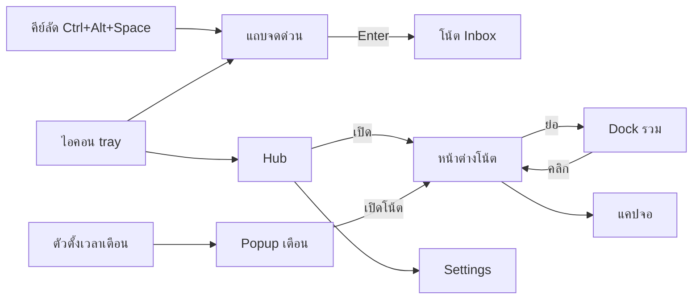

# 03 · UX / UI

ทุกหน้าจอในเอกสารนี้ต้องผ่านหลัก 7 ข้อใน `02-product.md` โดยเฉพาะ **จดก่อน** และ **ไม่เป็นภาระ**

---

## 1. แผนที่หน้าจอ



| หน้าจอ | ขนาดเริ่มต้น | ใช้เมื่อ |
| --- | --- | --- |
| แถบจดด่วน | 560 × 108, กลางจอที่เมาส์อยู่ | คิดอะไรได้ระหว่างทำงาน |
| หน้าต่างโน้ต | 320 × 380 (ย่อ/ขยายได้, ต่ำสุด 260 × 220) | ดู/แก้รายการงาน |
| Dock รวม | กว้าง 220, สูงตามจำนวนโน้ตที่ย่อ, มุมขวาล่างของจอ | เก็บโน้ตไว้ข้างจอโดยไม่บัง |
| Hub | 400 × 680 | ดูภาพรวม: วันนี้ / Inbox / โน้ต / เสร็จแล้ว |
| Popup เตือน | 340 × 120, เหนือ dock | ถึงเวลางาน |
| Settings | 640 × 520, หน้าต่างปกติมีกรอบ | ตั้งค่า |
| แคปจอ | เต็มจอ | ตัดภาพหน้าจอใส่โน้ต |

---

## 2. พฤติกรรมทั้งแอป

- **เปิดเครื่อง** (`--hidden`): ไม่เปิด Hub, คืนโน้ตที่แปะไว้และ dock, ตั้งเวลาเตือนต่อ
- **ปิดหน้าต่างทุกบาน** → แอปยังอยู่ใน tray (แจ้งครั้งแรกครั้งเดียว)
- **ออกจริง**: tray → ออกจาก WunWun
- **เปิดซ้ำ** (ดับเบิลคลิกไอคอนอีกครั้ง) → เรียก Hub ของตัวที่เปิดอยู่
- **ไม่ขโมยโฟกัส**: popup เตือนและโน้ตที่คืนตอนเปิดเครื่องใช้ `showInactive()`

### คีย์ลัดทั้งระบบ (ตั้งใหม่ได้ใน Settings)

| ค่าเริ่มต้น | ทำอะไร | หมายเหตุ |
| --- | --- | --- |
| `Ctrl+Alt+Space` | เปิดแถบจดด่วน | ห้ามใช้ `Ctrl+Space` (autocomplete ใน IDE, สลับ IME) และ `Ctrl+Shift+N` (Chrome/Explorer) |
| `Ctrl+Alt+W` | แสดง/ซ่อนโน้ตทั้งหมด | |
| `Ctrl+Alt+T` | เปิด Hub ที่แท็บ "วันนี้" | ใหม่ |
| — | แคปจอใส่ Inbox | ให้ผู้ใช้กำหนดเอง (ไม่มีค่าเริ่มต้น กันชน Win+Shift+S) |

ถ้าลงทะเบียนคีย์ไม่สำเร็จ: แจ้งครั้งเดียว + แสดงจุดเตือนที่ Settings → คีย์ลัด พร้อมปุ่ม "เลือกคีย์ใหม่"

---

## 3. แถบจดด่วน

```
┌──────────────────────────────────────────────────────────┐ ← เส้นบนสี accent
│ [W]  ส่ง artwork ให้ลูกค้าวันศุกร์ 10 โมง          Enter ↵ │
│      (งาน) (เตือน ศ. 9 ต.ค. 10:00) → ส่ง artwork ให้ลูกค้า │
└──────────────────────────────────────────────────────────┘
```

- โชว์ตัวอย่างผลแบบสดทุกครั้งที่พิมพ์: ประเภท + เวลาเตือน + ข้อความที่จะบันทึก
- **Enter** บันทึกลง Inbox แล้วปิด · **Esc** หรือคลิกนอกแถบ = ปิด (ข้อความที่พิมพ์ค้างจำไว้ 60 วินาที)
- **Shift+Enter** บันทึกแล้วเปิดแถบต่อ (จดหลายอย่างติดกัน)
- **Tab** วนประเภท: งาน → ไอเดีย → โน้ต (แก้การเดาของระบบได้ก่อนบันทึก)
- ขึ้นต้น `?` = ไอเดีย · `-` หรือ `[]` = งาน · URL ล้วน = ลิงก์
- **Ctrl+V รูป** → แสดง thumbnail เล็กในแถบ, บันทึกเป็นงานพร้อมรูป
- ปุ่มไอคอนแคปจอทางขวา (ต่อจาก Phase 2): ตัดภาพ → กลับมาที่แถบพร้อมรูป → พิมพ์ว่าต้องทำอะไร
- หลังบันทึก: เส้นบนเปลี่ยนเป็นสีเขียว 150 ms แล้วปิด; ถ้า Inbox เปิดอยู่ รายการใหม่กระพริบเบา ๆ

---

## 4. หน้าต่างโน้ต

### 4.1 โครง

```
┌──────────────────────────────────────┐ แถบสีโน้ต (ลากย้ายหน้าต่าง)
│ +  งานลูกค้า               📌  −  ⋯  × │
├──────────────────────────────────────┤
│ ☐ ● ส่ง artwork ให้ลูกค้า   [ศ. 10:00] │  ← งาน (task)
│ ☐ ● เช็กราคามอเตอร์                   │
│     ☐ ● ถาม 2 ร้าน                    │  ← indent 1
│ ## ของที่ต้องเตรียม                    │  ← หัวข้อ
│ 💡 สีนี้สวย reference งาน WP           │  ← ไอเดีย
│ ┌────────┐ reference.png  1.2 MB      │  ← การ์ดไฟล์/รูป
│ └────────┘ เปิด · เปิดโฟลเดอร์          │
│ 🔗 example.com                        │  ← ลิงก์ (Ctrl+คลิก)
│ ▸ เสร็จแล้ว (3)                        │
├──────────────────────────────────────┤
│ + เพิ่มงาน… ลองพิมพ์ "พรุ่งนี้ 9 โมง"     │ ← ช่องเพิ่มด้านล่างถาวร
│ [☑] [🖼] [✂] [📁] [✦]                │ ← แถบเครื่องมือ (โผล่เมื่อ hover/focus)
└──────────────────────────────────────┘
```

> ไอคอนในเอกสารเป็นตัวแทน — ใน UI จริงใช้ SVG ชุดเดียวกันทั้งแอป (เช่น Lucide, ISC license) วางเป็นไฟล์ในโปรเจกต์ ไม่ใช้อีโมจิสำหรับปุ่ม

- เปลี่ยนจากแถบเครื่องมือ B/I/U/S 8 ปุ่มถาวร → **ช่องเพิ่มงานด้านล่าง** + แถบเครื่องมือ 5 ปุ่มที่โผล่เมื่อ hover; จัดรูปแบบตัวอักษรด้วยคีย์ลัดหรือ bubble ตอนเลือกข้อความ
- หัวโน้ตแสดงชื่อ (บรรทัดแรกของโน้ต หรือชื่อที่ตั้ง) — ดับเบิลคลิกเพื่อตั้งชื่อเอง

### 4.2 ชนิดของรายการ (block)

| ชนิด | หน้าตา | สร้างจาก |
| --- | --- | --- |
| `task` | ☐ + ● priority + ข้อความ + ป้ายเวลา | ค่าเริ่มต้นของโน้ต, `[] `, ปุ่ม ☑ |
| `text` | ข้อความล้วน | `Ctrl+Shift+T` สลับ, หรือโน้ตที่ตั้งเป็น "โน้ตข้อความ" |
| `heading` | ตัวหนาใหญ่ | `# ` |
| `idea` | 💡 + พื้นจาง | `? ` |
| `link` | 🔗 โดเมน + URL | วาง URL ล้วน |
| `image` / `video` | รูปเต็มกว้าง / player | วาง/ลากไฟล์, แคปจอ |
| `file` | การ์ด: ไอคอนชนิด, ชื่อ, ขนาด, เปิด, เปิดโฟลเดอร์ | ลากไฟล์ |
| `folder` | 📁 ชื่อโฟลเดอร์ + path | ลากโฟลเดอร์, ปุ่ม 📁 |

### 4.3 คีย์บอร์ดในโน้ต

| คีย์ | ทำอะไร |
| --- | --- |
| `Enter` | อ่านวันเวลาในบรรทัด → ตั้งเตือน, แล้วสร้างรายการใหม่ชนิดเดียวกันด้านล่าง (ถ้าเคอร์เซอร์อยู่กลางข้อความ = ตัดแบ่งเป็น 2 รายการ) |
| `Shift+Enter` | ขึ้นบรรทัดใหม่ในรายการเดิม |
| `Tab` / `Shift+Tab` | เยื้องเข้า / ออก (0–3) |
| `Backspace` ที่ต้นรายการว่าง | ลบรายการ เคอร์เซอร์ไปท้ายรายการบน |
| `Backspace` ที่ต้นรายการมีข้อความ | รวมกับรายการบน |
| `Ctrl+Enter` | ติ๊กเสร็จ / ยกเลิก |
| `Alt+↑` / `Alt+↓` | ย้ายรายการขึ้น/ลง |
| `↑` / `↓` ที่บรรทัดแรก/สุดท้ายของรายการ | ไปรายการบน/ล่าง |
| `Ctrl+B / I / U`, `Ctrl+Shift+X` | ตัวหนา / เอียง / ขีดเส้นใต้ / ขีดฆ่า |
| `Ctrl+K` (ในโน้ต) | ใส่ลิงก์กับข้อความที่เลือก |
| `Ctrl+D` | เปิดตัวเลือกวันเวลาเล็ก (วันนี้เย็น / พรุ่งนี้เช้า / สัปดาห์หน้า / เลือกเอง) |
| `Ctrl+Shift+S` | ติดดาว (Focus) |
| `Ctrl+Z` / `Ctrl+Shift+Z` | ย้อน / ทำซ้ำ (ระดับรายการ ไม่ใช่ของเบราว์เซอร์) |
| `Esc` | ออกจากการแก้ไข, ถ้าไม่มีอะไรแก้อยู่ = ย่อเป็น dock |

**พิมพ์ไทย:** ห้ามจัดการ `Enter`/`Backspace` ขณะ `event.isComposing === true` และอย่าแปลงข้อความระหว่าง composition (รองรับ IME ภาษาอื่นด้วย)

### 4.4 ป้ายเวลา (when-chip)
- แสดงท้ายรายการ: `วันนี้ 14:00`, `พรุ่งนี้ 09:00`, `ศ. 9 ต.ค. 10:00`, `ทุกวันทำงาน 08:30`
- สี: ปกติ = accent ของโน้ต · เลยเวลาและยังไม่ติ๊ก = แดง · ภายใน 1 ชม. = เข้มขึ้น
- คลิก → เมนูเล็ก: เลื่อน 1 ชม. / พรุ่งนี้เช้า / เลือกเวลา / ลบเตือน (คืนข้อความเดิมที่พิมพ์ไว้)
- งานซ้ำ: ติ๊กแล้วเลื่อนไปรอบถัดไป ไม่ย้ายลง "เสร็จแล้ว" (แสดง toast "เลื่อนไป พฤ. 08:30 · ยกเลิก")

### 4.5 ส่วน "เสร็จแล้ว"
- ติ๊กแล้วรายการเลื่อนลงช้า ๆ 220 ms ไปอยู่ในส่วนพับ "เสร็จแล้ว (n)"
- toast "เสร็จ 1 งาน · ยกเลิก" 5 วินาที
- เก็บงานที่เสร็จไว้ในโน้ต 30 วัน แล้วย้ายไปแท็บ "เสร็จแล้ว" ของ Hub (ไม่ลบ)

### 4.6 ลาก วาง และวางจากคลิปบอร์ด
| สิ่งที่วาง | ผล |
| --- | --- |
| ข้อความหลายบรรทัด | แตกเป็นหลายรายการ (บรรทัดว่างข้าม), ขึ้นต้น `- ` `* ` `1.` `[ ]` `[x]` แปลงเป็นงาน |
| HTML จากเว็บ/Word | เก็บเฉพาะข้อความ + ตัวหนา/เอียง/ลิงก์ (ไม่เก็บ HTML ดิบ) |
| รูป (คลิปบอร์ดหรือไฟล์) | บันทึกเป็นไฟล์ใน attachments + รายการรูป |
| ไฟล์อื่น ≤ 100 MB | คัดลอกเข้า attachments (ตั้งค่าได้: คัดลอก / แค่ลิงก์) |
| โฟลเดอร์ | รายการโฟลเดอร์ (ลิงก์ ไม่คัดลอก) |
| URL | รายการลิงก์ |
| ลากรายการระหว่างโน้ต | ย้ายรายการไปโน้ตปลายทาง |

### 4.7 สถานะว่าง
- โน้ตใหม่: placeholder "พิมพ์งานแรก… ลอง ส่งงานพรุ่งนี้ 10 โมง"
- Inbox ว่าง: "ว่างเปล่า ดีมาก · กด Ctrl+Alt+Space เพื่อจด"

---

## 5. Dock รวม

```
┌──────────────────────────┐
│ ● งานลูกค้า          3  ⌃ │  ← จุดสีโน้ต, ชื่อ, งานค้าง
│ ● Inbox              5  ⌃ │
│ ● ร้านค้า        ⚠ 2   ⌃ │  ← ⚠ = เลยกำหนด (สีแดง)
└──────────────────────────┘
```
- หน้าต่างเดียวรวมทุกโน้ตที่ย่อ ซ้อนจากล่างขึ้นบน มุมขวาล่างของจอ (ตั้งมุมได้)
- คลิกแถว = กางโน้ตคืนตำแหน่งเดิม · ลากแถว = เรียงใหม่ · คลิกขวา = สี/ปักหมุด/ปิด
- ย่อโน้ต = ปิด renderer ของโน้ตนั้น (ประหยัด RAM) แล้วเพิ่มแถวใน dock
- ซ่อน dock ทั้งแผงได้ด้วย `Ctrl+Alt+W`

---

## 6. Hub

```
┌──────────────────────────────────────┐
│ WunWun                 ⟳ ซิงก์แล้ว  ⚙ × │
│ [วันนี้ 4] [Inbox 5] [โน้ต] [เสร็จแล้ว]  │
│ 🔍 ค้นหา…  (Ctrl+K)                   │
├──────────────────────────────────────┤
│ เลยกำหนด                              │
│  ☐ จ่ายค่าเน็ต          เมื่อวาน 09:00 │
│ วันนี้                                 │
│  09:00 ☐ เช็ก order          ร้านค้า   │
│  14:00 ☐ ประชุมทีม           Inbox    │
│ ไม่มีเวลา · ติดดาว                     │
│  ★ ☐ ส่ง artwork            งานลูกค้า │
├──────────────────────────────────────┤
│ เสร็จวันนี้ 3 · ค้าง 4                  │
│ [+ โน้ตใหม่]                           │
└──────────────────────────────────────┘
```

| แท็บ | แสดง | การกระทำ |
| --- | --- | --- |
| **วันนี้** (ค่าเริ่มต้น) | เลยกำหนด → วันนี้ตามเวลา → ติดดาวที่ไม่มีเวลา | ติ๊ก, เลื่อนเวลา, คลิกชื่อโน้ตเพื่อเปิด |
| **Inbox** | รายการใน Inbox ใหม่สุดบน | ติ๊ก, ย้ายไปโน้ตอื่น (ลาก/เมนู), แปลงชนิด, เก็บถาวร |
| **โน้ต** | การ์ดโน้ต (แทนแท็บ All เดิม) เรียงลากได้ | เปิด, สี, ลบ (ย้อนได้ 10 วินาที) |
| **เสร็จแล้ว** | งานที่เสร็จ จัดกลุ่มตามวัน | ยกเลิกติ๊ก |

- แท็บ Tasks/Projects/Focus เดิม **เลิกใช้** (Projects เดาจากคำว่า "project" ไม่แม่น; Focus ไปอยู่ใน "วันนี้")
- แถวบนแสดงสถานะซิงก์: `ใช้ในเครื่อง` · `ซิงก์แล้ว` · `กำลังส่ง 3` · `ออฟไลน์` · `ซิงก์ไม่สำเร็จ ↻`

### ค้นหา (Ctrl+K)
- ช่องค้นหาลอยกลาง Hub, ผลแบ่งกลุ่ม: งาน · โน้ต · ไฟล์ · เสร็จแล้ว
- ↑↓ เลือก, Enter เปิดโน้ตและเลื่อนไปที่รายการนั้น (ไฮไลต์ 1 วินาที)
- ค้นภาษาไทยได้กลางคำ (ใช้ FTS5 trigram; คำสั้นกว่า 3 ตัวอักษรใช้ LIKE)

---

## 7. Popup เตือน

```
┌──────────────────────────────────┐
│ ⏰ ถึงเวลา · งานลูกค้า        × │
│ ส่ง artwork ให้ลูกค้า              │
│ [เสร็จแล้ว] [10 นาที] [1 ชม.] [พรุ่งนี้] │
└──────────────────────────────────┘
```
- ขึ้นเหนือ dock แบบไม่ขโมยโฟกัส, ซ้อนได้ 3 ใบ เกินนั้นรวมเป็น "อีก n งาน"
- ไม่กดอะไร 60 วินาที → ย่อเป็นตัวเลขบนไอคอน tray และแถว "เตือนที่พลาด" ใน Hub แท็บวันนี้
- Settings → การเตือน: `Popup ของ WunWun` (ค่าเริ่มต้น) · `การแจ้งเตือนของ Windows` · `ทั้งสองแบบ` · เสียง เปิด/ปิด · ช่วงห้ามรบกวน (เช่น 22:00–07:00)
- เปิดเครื่องหลังพลาดเตือน > 12 ชม. → แจ้งรวมครั้งเดียว "พลาดการเตือน n งาน"

---

## 8. Settings (หน้าต่างปกติ มีกรอบ)

| หมวด | ตัวเลือก |
| --- | --- |
| ทั่วไป | ภาษา (ไทย/English), ธีม (มืด/สว่าง/ตามระบบ), เปิดพร้อมเครื่อง, มุมของ dock |
| คีย์ลัด | บันทึกคีย์ด้วยการกดจริง, ตรวจชนก่อนบันทึก, คืนค่าเริ่มต้น |
| การเตือน | รูปแบบ, เสียง, ห้ามรบกวน, เวลาเริ่มต้นเมื่อไม่ระบุเวลา (09:00) |
| โน้ต | สีเริ่มต้น, ความโปร่งใสเริ่มต้น (60–100%), โน้ตใหม่เป็นงานหรือข้อความ, ไฟล์ที่ลาก: คัดลอก/ลิงก์ |
| บัญชีและซิงก์ | เข้าสู่ระบบด้วยอีเมล (รหัส 6 หลัก), รายการอุปกรณ์, ซิงก์ตอนนี้, ออกจากระบบ (เก็บ/ลบข้อมูลในเครื่อง), ลบบัญชี |
| AI | ปิด · กฎในเครื่องเท่านั้น (ค่าเริ่มต้น) · ใช้คีย์ของฉัน · WunWun Cloud (ต้องล็อกอิน) |
| ข้อมูล | ส่งออกทั้งหมด, นำเข้า, เปิดโฟลเดอร์ข้อมูล, คืนจากสำรอง (เลือกวัน) |
| เกี่ยวกับ | เวอร์ชัน, ตรวจอัปเดต, ส่ง crash report (ปิดเป็นค่าเริ่มต้น), เปิด log |

---

## 9. ครั้งแรกที่เปิด

1. Hub เปิดที่แท็บ Inbox ที่มี 3 รายการสอนใช้งาน:
   - ☐ กด **Ctrl+Alt+Space** แล้วพิมพ์อะไรก็ได้ ลองเลย
   - ☐ พิมพ์ "**พรุ่งนี้ 9 โมง**" ท้ายงานแล้ว Enter เพื่อตั้งเตือน
   - ☐ กด **−** เพื่อเก็บโน้ตไว้ที่ dock มุมจอ
2. ติ๊กครบ 3 ข้อ → "พร้อมแล้ว ✓" และรายการหายไปเอง
3. ไม่มี wizard หลายหน้า ไม่บังคับสมัครบัญชี

---

## 10. ภาษาและน้ำเสียง

- เป็นกันเอง สั้น ไม่ทำให้รู้สึกผิด: "ค้าง 3 งาน" ไม่ใช่ "คุณยังทำไม่เสร็จ 3 งาน!"
- ปุ่มเป็นคำกริยา: "เลื่อน 1 ชม.", "ย้ายไปโน้ต…", "ลบการเตือน"
- ข้อผิดพลาดบอกวิธีแก้: "ซิงก์ไม่สำเร็จ · ไม่มีเน็ต จะลองใหม่เอง" ไม่ใช่ "Error 503"
- ตัวเลขเวลาแบบ 24 ชม. (`14:00`), วันที่แบบไทยย่อ (`ศ. 9 ต.ค.`), ปี พ.ศ. 2 หลักเมื่อข้ามปี
- ข้อความ UI ทั้งหมดอยู่ใน `src/renderer/shared/i18n/th.js` (+ `en.js`) ห้ามเขียนตรงในโค้ด

---

## 11. Visual design

### 11.1 Tokens (`src/renderer/shared/tokens.css`)

```css
:root {
  /* พื้นโน้ต (ธีมมืด = ตัวตนเดิมของ WunWun) */
  --surface-note: #2b2b2b;
  --surface-hub: #1e1e1e;
  --surface-raised: #333333;
  --text: #f4f4f4;            /* 12.9:1 บน #2b2b2b */
  --text-muted: #a0a0a0;      /* 5.4:1 */
  --line: rgba(255, 255, 255, 0.09);
  --danger: #ff8a7a;          /* ข้อความแดงบนพื้นมืด 6.2:1 */
  --success: #2ecc71;

  /* ระยะ / มุม / เวลา */
  --space-1: 4px; --space-2: 8px; --space-3: 12px; --space-4: 16px; --space-6: 24px;
  --radius-s: 6px; --radius-m: 10px; --radius-l: 14px;
  --dur-fast: 150ms; --dur-base: 220ms; --ease: cubic-bezier(.2,.8,.2,1);

  /* ตัวอักษร: Thai ต้อง line-height ≥ 1.5 เพราะมีสระบน/ล่าง */
  --font: "Segoe UI Variable Text", "Segoe UI", "Leelawadee UI", "Noto Sans Thai", system-ui, sans-serif;
  --fs-s: 12px; --fs-m: 14px; --fs-l: 16px; --fs-xl: 18px;
  --lh: 1.5;
}

/* สีโน้ต: bar = แถบหัว, on-bar = ตัวหนังสือบนแถบ, accent = สีตัวหนังสือ/ป้ายบนพื้นโน้ตมืด */
[data-color="yellow"] { --bar: #f1c40f; --on-bar: #1a1a1a; --accent: #f1c40f; }
[data-color="red"]    { --bar: #e74c3c; --on-bar: #1a1a1a; --accent: #ff8a7a; }
[data-color="blue"]   { --bar: #3498db; --on-bar: #1a1a1a; --accent: #5dade2; }
[data-color="green"]  { --bar: #2ecc71; --on-bar: #1a1a1a; --accent: #2ecc71; }
[data-color="purple"] { --bar: #9b59b6; --on-bar: #ffffff; --accent: #c39bd3; }
[data-color="orange"] { --bar: #e67e22; --on-bar: #1a1a1a; --accent: #f5b041; }

@media (prefers-color-scheme: light) {
  :root:not([data-theme="dark"]) {
    --surface-note: #fffdf5; --surface-hub: #f6f6f4; --surface-raised: #ffffff;
    --text: #1f1f1f; --text-muted: #5f5f5f; --line: rgba(0, 0, 0, 0.1); --danger: #b03a2e;
  }
  :root:not([data-theme="dark"]) [data-color="yellow"] { --accent: #7d6608; }
  :root:not([data-theme="dark"]) [data-color="red"]    { --accent: #b03a2e; }
  :root:not([data-theme="dark"]) [data-color="blue"]   { --accent: #1f618d; }
  :root:not([data-theme="dark"]) [data-color="green"]  { --accent: #1e8449; }
  :root:not([data-theme="dark"]) [data-color="purple"] { --accent: #6c3483; }
  :root:not([data-theme="dark"]) [data-color="orange"] { --accent: #af601a; }
}
```

ค่าความต่างสีที่ตรวจแล้ว: ตัวหนังสือดำ `#1a1a1a` บนแถบเหลือง 10.5:1, แดง 4.6:1, ฟ้า 5.5:1, เขียว 8.3:1, ส้ม 6.1:1; **แถบม่วงต้องใช้ตัวหนังสือขาว** (4.7:1 เทียบกับดำ 3.7:1). เดิมแอปใช้สีโน้ตเป็นสีตัวหนังสือบนพื้นมืดตรง ๆ ซึ่งแดง (3.7:1) และม่วง (3.0:1) อ่านยาก → ใช้ `--accent` ข้างบน

- เก็บสีในข้อมูลเป็น **ชื่อ** (`yellow`) ไม่ใช่ hex เพื่อเปลี่ยนธีมได้
- ความโปร่งใสของหน้าต่าง 60–100% (`win.setOpacity`), hover แล้วทึบ 100% ชั่วคราว
- เงา: ไม่ใช้เงาหนัก (หน้าต่าง frameless บน Windows 11 ได้มุมโค้ง/เงาจากระบบอยู่แล้ว)
- Motion: เคารพ `prefers-reduced-motion` (ปิดแอนิเมชันเลื่อน/กระพริบ)

### 11.2 การเข้าถึง
- ทุกปุ่มใช้ได้ด้วยคีย์บอร์ด, `:focus-visible` ชัด (ขอบ 2 px สี accent)
- ปุ่มไอคอนมี `aria-label` ภาษาไทย; checkbox ใช้ `<input type=checkbox>` จริง
- ขนาดคลิกขั้นต่ำ 28 × 28 px (หน้าต่างเล็ก) / 32 × 32 px ใน Hub
- ตัวหนังสือไทยต่ำสุด 12 px

### 11.3 หลายจอ และ DPI
- เก็บ `display_id` + ตำแหน่งต่อโน้ตใน `window_state` (เฉพาะเครื่อง ไม่ซิงก์)
- เปิดแอปแล้วจอเดิมหาย → ย้ายโน้ตมาจอหลัก โดยคงลำดับเรียง ไม่ทับกัน
- ทดสอบที่ scale 100%, 125%, 150%, 175% และจอ 2 จอที่ scale ต่างกัน
