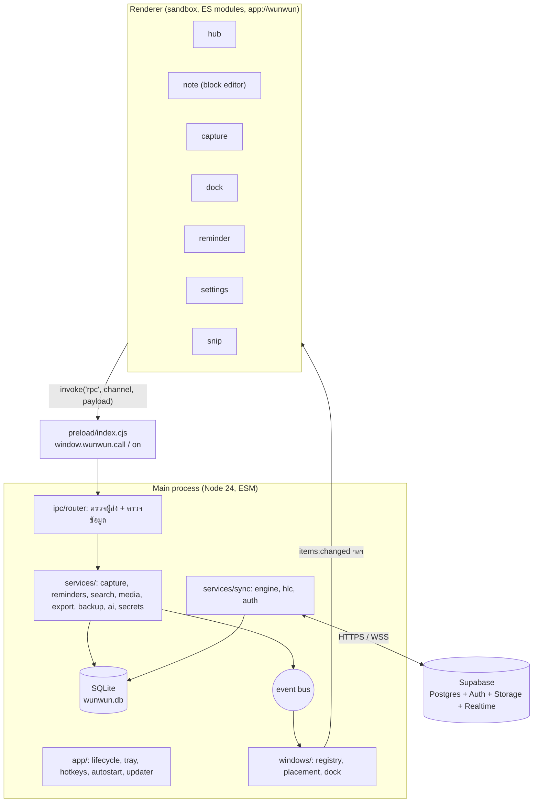

# 05 · สถาปัตยกรรมและโครงสร้างโค้ด

## 1. ภาพรวม



หลักใหญ่:
1. **Main process เป็นเจ้าของข้อมูลคนเดียว** — renderer ไม่เขียน DB/ไฟล์เอง, ไม่เห็น token, ไม่เรียกเน็ต
2. **Renderer ไม่มี Node** — `sandbox: true`, `contextIsolation: true`, โหลดจาก custom protocol `app://wunwun/`
3. **ทุกอย่างผ่าน router เดียว** — ช่อง `rpc` ช่องเดียว + allowlist ของ channel + validator
4. **อัปเดตแบบละเอียด** — event บอกเฉพาะสิ่งที่เปลี่ยน ไม่ส่ง store ทั้งก้อน
5. **ทำงานได้ทันทีไม่รอเน็ต** — เขียน DB ก่อน แล้ว sync engine ค่อยส่งทีหลัง

## 2. รูปแบบโมดูล

| ส่วน | รูปแบบ | เหตุผล |
| --- | --- | --- |
| `package.json` | `"type": "module"`, `"main": "src/main/index.js"` | Electron รองรับ ESM ใน main มานานแล้ว; ใช้ `import.meta.dirname` แทน `__dirname` |
| main + shared | ESM (`.js`) | ใช้ร่วมกับ renderer ได้ตรง ๆ |
| preload | CommonJS (`src/preload/index.cjs`) ไฟล์เดียว ไม่ `require` ไฟล์อื่น | preload ที่ sandbox ต้องเป็นไฟล์เดียวที่ใช้ได้แค่โมดูล Electron ชุดจำกัด |
| renderer | `<script type="module">` | ไม่มี bundler; โหลดผ่าน `app://` จึงใช้ ES module ได้ |
| type checking | JSDoc + `// @ts-check` + `tsc --noEmit` (`jsconfig.json`) | ได้ความปลอดภัยของ type โดยยังเป็น Vanilla JS ไม่มี build step |

## 3. โครงโฟลเดอร์เป้าหมาย

```
wunwun/
├─ CLAUDE.md                     # กติกาสำหรับ Claude Code (อ่านก่อนทำงาน)
├─ package.json                  # type: module
├─ electron-builder.yml
├─ jsconfig.json                 # checkJs สำหรับ tsc --noEmit
├─ docs/plan/                    # เอกสารชุดนี้
├─ assets/                       # icon.png, tray.png, icons/*.svg
├─ src/
│  ├─ main/
│  │  ├─ index.js                # bootstrap: ลำดับการเริ่มแอปเท่านั้น
│  │  ├─ app/
│  │  │  ├─ lifecycle.js         # single instance, before-quit, session-end, powerMonitor
│  │  │  ├─ protocol.js          # app:// และ wunwun-media:// + CSP header
│  │  │  ├─ tray.js
│  │  │  ├─ hotkeys.js
│  │  │  ├─ autostart.js
│  │  │  ├─ updater.js
│  │  │  └─ paths.js             # userData, portable mode, โฟลเดอร์ข้อมูล
│  │  ├─ windows/
│  │  │  ├─ registry.js          # createWindow(kind) + ค่าความปลอดภัยเริ่มต้น + forward events
│  │  │  ├─ hub.js · note.js · capture.js · dock.js · reminder.js · settings.js · snip.js
│  │  │  └─ placement.js         # จอ, DPI, คืนตำแหน่ง, กันหน้าต่างหลุดจอ
│  │  ├─ ipc/
│  │  │  ├─ router.js
│  │  │  ├─ validate.js          # validator เล็ก ๆ ไม่ใช้ไลบรารี
│  │  │  └─ routes/              # notes.js items.js capture.js media.js search.js settings.js auth.js sync.js ai.js export.js app.js
│  │  ├─ db/
│  │  │  ├─ index.js             # เปิด DB, PRAGMA, migrate, quick_check
│  │  │  ├─ driver.js            # adapter: node:sqlite หรือ better-sqlite3
│  │  │  ├─ migrations/          # 0001_init.sql, 0002_….sql (เพิ่มอย่างเดียว ห้ามแก้ไฟล์เก่า)
│  │  │  ├─ legacy-import.js     # wunwun_data.json v1.x → SQLite
│  │  │  └─ repos/               # notes.js items.js attachments.js settings.js window-state.js meta.js
│  │  ├─ services/
│  │  │  ├─ bus.js               # EventEmitter กลาง
│  │  │  ├─ capture.js · reminders.js · search.js · media.js · export.js · backup.js · ai.js · secrets.js
│  │  │  └─ sync/                # engine.js hlc.js auth.js supabase.js attachments.js merge.js
│  │  └─ util/                   # ids.js (uuid v7) fractional-index.js log.js
│  ├─ preload/
│  │  └─ index.cjs
│  ├─ renderer/
│  │  ├─ shared/                 # tokens.css base.css api.js i18n/{th,en}.js ui/*.js icons.js
│  │  ├─ hub/                    # index.html hub.js hub.css views/{today,inbox,notes,done,search}.js
│  │  ├─ note/                   # index.html note.js note.css editor/{block-list,block-row,keymap,marks-dom,paste,drag,undo}.js
│  │  ├─ capture/ · dock/ · reminder/ · settings/ · snip/ · importer/ (หน้าต่างซ่อนแปลง HTML v1)
│  └─ shared/                    # ใช้ได้ทั้ง main และ renderer
│     ├─ when-parser.js          # จาก v1.1.0
│     ├─ marks.js                # markdown-lite ↔ โครงสร้าง (ไม่มี HTML ดิบ)
│     ├─ format.js               # formatWhen, ขนาดไฟล์, วันที่ไทย
│     └─ constants.js            # ชนิด block, สี, ขีดจำกัด
├─ supabase/
│  ├─ migrations/                # SQL ฝั่งเซิร์ฟเวอร์
│  └─ functions/                 # ai-assist, delete-account
├─ tests/
│  ├─ unit/                      # node:test
│  ├─ e2e/                       # Playwright _electron
│  └─ fixtures/legacy/           # wunwun_data.json ตัวอย่างหลายแบบ
└─ web/                          # landing page (Vercel)
```

## 4. ลำดับการเริ่มแอป (`src/main/index.js`)

```js
// ลำดับสำคัญ: protocol ต้องลงทะเบียนก่อน ready, DB ต้องพร้อมก่อนสร้างหน้าต่าง
import { app } from 'electron';
import { registerSchemes, handleProtocols } from './app/protocol.js';
import { ensureSingleInstance, wireLifecycle } from './app/lifecycle.js';
import { resolvePaths } from './app/paths.js';
import { openDatabase } from './db/index.js';
import { importLegacyIfNeeded } from './db/legacy-import.js';
import { attachmentFileFor } from './db/repos/attachments.js';
import { installRouter } from './ipc/router.js';
import { registerAllRoutes } from './ipc/routes/index.js';
import { createTray } from './app/tray.js';
import { registerHotkeys } from './app/hotkeys.js';
import { applyAutoStart } from './app/autostart.js';
import { startReminderScheduler } from './services/reminders.js';
import { restoreWindows, prewarmCapture, openHub } from './windows/registry.js';
import { startBackups } from './services/backup.js';
import { startSync } from './services/sync/engine.js';
import { startUpdater } from './app/updater.js';

if (!ensureSingleInstance()) app.exit(0);
registerSchemes();

app.whenReady().then(async () => {
  const paths = resolvePaths();
  const db = openDatabase(paths.dbFile);          // migrate + quick_check + กู้จากสำรองถ้าเสีย
  handleProtocols(paths, (id) => attachmentFileFor(db, id));
  await importLegacyIfNeeded(db, paths);          // v1.x → SQLite ครั้งเดียว
  installRouter(); registerAllRoutes(db);
  wireLifecycle();
  createTray(); registerHotkeys(); applyAutoStart();
  prewarmCapture();
  if (!process.argv.includes('--hidden')) openHub();
  restoreWindows();
  startReminderScheduler(db);
  startBackups(db, paths);
  startSync(db);                                   // ไม่ทำอะไรถ้ายังไม่ล็อกอิน
  startUpdater();
});
```

## 5. Custom protocol

| scheme | เสิร์ฟ | สิทธิ์ |
| --- | --- | --- |
| `app://wunwun/renderer/...` | `src/renderer/` | standard, secure, supportFetchAPI |
| `app://wunwun/shared/...` | `src/shared/` | เหมือนข้างบน |
| `app://wunwun/assets/...` | `assets/` | เหมือนข้างบน |
| `wunwun-media://att/<attachmentId>` | ไฟล์ใน `<data>/attachments/` | + stream (วิดีโอ seek ได้) |

```js
// src/main/app/protocol.js (ย่อ)
import { protocol, net } from 'electron';
import path from 'node:path';
import { pathToFileURL } from 'node:url';

const MIME = { '.html': 'text/html', '.js': 'text/javascript', '.css': 'text/css',
  '.svg': 'image/svg+xml', '.png': 'image/png', '.json': 'application/json', '.woff2': 'font/woff2' };
export const CSP = [
  "default-src 'self'", "script-src 'self'", "style-src 'self' 'unsafe-inline'",
  "img-src 'self' wunwun-media: data: blob:", "media-src 'self' wunwun-media: blob:",
  "connect-src 'self'", "object-src 'none'", "base-uri 'none'", "form-action 'none'", "frame-ancestors 'none'"
].join('; ');

export function registerSchemes() {
  protocol.registerSchemesAsPrivileged([
    { scheme: 'app', privileges: { standard: true, secure: true, supportFetchAPI: true } },
    { scheme: 'wunwun-media', privileges: { standard: true, secure: true, supportFetchAPI: true, stream: true } }
  ]);
}

/** ต่อ path แบบกันหลุดออกนอก root (กัน ../) */
export function safeJoin(root, rel) {
  const target = path.resolve(root, '.' + path.posix.normalize('/' + decodeURIComponent(rel)));
  if (target !== root && !target.startsWith(root + path.sep)) throw new Error('path escape');
  return target;
}

export function handleProtocols({ appRoot, attachmentsDir }, getAttachmentFile) {
  const roots = { renderer: path.join(appRoot, 'src/renderer'), shared: path.join(appRoot, 'src/shared'), assets: path.join(appRoot, 'assets') };
  protocol.handle('app', async (req) => {
    const { host, pathname } = new URL(req.url);
    const [, top, ...rest] = pathname.split('/');
    if (host !== 'wunwun' || !roots[top]) return new Response('Not found', { status: 404 });
    const file = safeJoin(roots[top], rest.join('/'));
    const res = await net.fetch(pathToFileURL(file).toString());
    const headers = new Headers(res.headers);
    headers.set('Content-Type', MIME[path.extname(file)] || 'application/octet-stream');
    if (file.endsWith('.html')) headers.set('Content-Security-Policy', CSP);
    return new Response(res.body, { status: res.status, headers });
  });
  protocol.handle('wunwun-media', async (req) => {
    const id = new URL(req.url).pathname.replace(/^\/+/, '');
    const file = getAttachmentFile(id);             // ค้นจาก DB เท่านั้น ไม่รับ path จาก URL
    if (!file) return new Response('Not found', { status: 404 });
    return net.fetch(pathToFileURL(safeJoin(attachmentsDir, file)).toString(), { headers: req.headers });
  });
}
```

## 6. IPC

### 6.1 Router

```js
// src/main/ipc/router.js
import { ipcMain, BrowserWindow } from 'electron';
const ORIGIN = 'app://wunwun/';
const routes = new Map();

/** @param {string} channel @param {(x:unknown)=>any} validate @param {(input:any, ctx:{win:BrowserWindow|null, sender:Electron.WebContents})=>any} handler */
export function route(channel, validate, handler) {
  if (routes.has(channel)) throw new Error(`duplicate route ${channel}`);
  routes.set(channel, { validate, handler });
}

export function installRouter() {
  ipcMain.handle('rpc', async (event, channel, payload) => {
    if (!event.senderFrame || !event.senderFrame.url.startsWith(ORIGIN)) throw new Error('E_FORBIDDEN');
    const r = routes.get(channel);
    if (!r) throw new Error('E_UNKNOWN_CHANNEL');
    let input;
    try { input = r.validate(payload); } catch (err) { throw new Error(`E_INVALID: ${err.message}`); }
    return r.handler(input, { win: BrowserWindow.fromWebContents(event.sender), sender: event.sender });
  });
}
```

```js
// src/main/ipc/validate.js — validator ขนาดเล็กพอใช้ ไม่ต้องลง zod
export const v = {
  string: ({ max = 10_000, min = 0 } = {}) => (x) => { if (typeof x !== 'string' || x.length > max || x.length < min) throw new Error('string'); return x; },
  id: () => (x) => { if (typeof x !== 'string' || !/^[0-9a-f-]{36}$/.test(x)) throw new Error('id'); return x; },
  int: ({ min = -Infinity, max = Infinity } = {}) => (x) => { if (!Number.isInteger(x) || x < min || x > max) throw new Error('int'); return x; },
  bool: () => (x) => { if (typeof x !== 'boolean') throw new Error('bool'); return x; },
  oneOf: (...vals) => (x) => { if (!vals.includes(x)) throw new Error('oneOf'); return x; },
  iso: () => (x) => { if (typeof x !== 'string' || Number.isNaN(Date.parse(x))) throw new Error('iso'); return x; },
  optional: (f) => (x) => (x === undefined || x === null ? x : f(x)),
  array: (f, { max = 1000 } = {}) => (x) => { if (!Array.isArray(x) || x.length > max) throw new Error('array'); return x.map(f); },
  object: (shape) => (x) => {
    if (!x || typeof x !== 'object' || Array.isArray(x)) throw new Error('object');
    for (const k of Object.keys(x)) if (!(k in shape)) throw new Error(`unknown key ${k}`);
    return Object.fromEntries(Object.entries(shape).map(([k, f]) => [k, f(x[k])]));
  },
  none: () => (x) => { if (x !== undefined) throw new Error('none'); return undefined; }
};
```

### 6.2 Preload

```js
// src/preload/index.cjs
const { contextBridge, ipcRenderer, webUtils } = require('electron');
const EVENTS = new Set(['items:changed', 'notes:changed', 'settings:changed', 'sync:status',
  'capture:show', 'reminder:show', 'theme:changed', 'window:collapsed']);
contextBridge.exposeInMainWorld('wunwun', {
  call: (channel, payload) => ipcRenderer.invoke('rpc', channel, payload),
  on: (event, cb) => {
    if (!EVENTS.has(event)) throw new Error(`unknown event ${event}`);
    const h = (_e, data) => cb(data);
    ipcRenderer.on(event, h);
    return () => ipcRenderer.removeListener(event, h);
  },
  pathForFile: (file) => { try { return webUtils.getPathForFile(file); } catch { return ''; } }
});
```

### 6.3 สัญญา channel (renderer → main)

| channel | payload | คืนค่า |
| --- | --- | --- |
| `notes:list` | `{ includeArchived? }` | `NoteSummary[]` (id, title, color, isInbox, openCount, overdueCount, updatedAt) |
| `notes:get` | `{ id }` | `{ note, items: Item[] }` |
| `notes:create` | `{ color?, kind?: 'task'\|'text' }` | `Note` (และเปิดหน้าต่าง) |
| `notes:update` | `{ id, patch: { title?, color?, position? } }` | `Note` |
| `notes:delete` / `notes:restore` | `{ id }` | `{ ok }` |
| `notes:open` / `notes:collapse` | `{ id }` | `{ ok }` |
| `win:set` | `{ pinned?, opacity? }` (หน้าต่างผู้เรียก) | `{ ok }` |
| `win:close` / `win:minimize` | — | `{ ok }` |
| `items:create` | `{ noteId, after?, before?, type, text?, indent? }` | `Item` |
| `items:update` | `{ id, patch: { text?, type?, indent?, priority?, starred? } }` | `Item` |
| `items:toggle` | `{ id, checked }` | `Item` (งานซ้ำ → เลื่อนรอบ) |
| `items:move` | `{ ids, toNoteId?, after?, before? }` | `Item[]` |
| `items:delete` / `items:restore` | `{ ids }` | `{ ok }` |
| `items:setWhen` | `{ id, at, repeat?, hasTime, source? }` | `Item` |
| `items:clearWhen` | `{ id, restoreSource }` | `Item` |
| `items:snooze` | `{ id, minutes? , until? }` | `Item` |
| `today:list` | `{ now? }` | `{ overdue, today, starred, missed }` |
| `inbox:list` / `done:list` | `{ cursor? }` | `Item[]` |
| `search:query` | `{ q, limit? }` | `SearchHit[]` |
| `capture:submit` | `{ text, kind?, attachmentId? }` | `{ ok, itemId, label? }` |
| `capture:hide` | — | — |
| `media:importPath` | `{ path }` (ได้จาก `pathForFile` ตอน drop เท่านั้น) | `Attachment` |
| `media:importBytes` | `{ mime, bytes: Uint8Array, name? }` (วาง/แคปจอ) | `Attachment` |
| `media:open` / `media:reveal` | `{ attachmentId }` | `{ ok }` |
| `folder:open` | `{ itemId }` (path อ่านจาก DB) | `{ ok }` |
| `snip:start` | `{ target: 'note'\|'capture' }` | `Attachment \| null` |
| `export:note` | `{ id, format: 'md'\|'txt'\|'html'\|'png' }` | `{ ok, filePath }` |
| `export:all` / `import:folder` | — | `{ ok, path }` |
| `settings:get` / `settings:set` | `{ keys? }` / `{ key, value }` | `Settings` |
| `hotkeys:try` | `{ action, accelerator }` | `{ ok, reason? }` |
| `auth:status` / `auth:sendCode` / `auth:verify` / `auth:signOut` | ดู `07-sync.md` | |
| `sync:now` / `sync:status` | — | `SyncStatus` |
| `ai:run` | `{ action, text }` | `{ text?, items? }` |
| `app:info` / `app:openDataFolder` / `app:checkUpdate` | — | |

**Event (main → renderer):** `items:changed {noteId, ids}`, `notes:changed {ids}`, `settings:changed {keys}`, `sync:status {...}`, `capture:show`, `reminder:show {item}`, `theme:changed`, `window:collapsed`.
หน้าต่างโน้ตรับเฉพาะ event ของโน้ตตัวเอง; Hub และ dock รับทั้งหมด

## 7. หน้าต่าง

```js
// src/main/windows/registry.js (หัวใจ: ค่าความปลอดภัยรวมศูนย์)
const SECURE = { contextIsolation: true, sandbox: true, nodeIntegration: false, webSecurity: true,
  spellcheck: false, preload: path.join(appRoot, 'src/preload/index.cjs') };
export function createWindow(kind, { url, ...opts }) {
  const win = new BrowserWindow({ show: false, backgroundColor: '#00000000', ...opts, webPreferences: { ...SECURE } });
  win.webContents.setWindowOpenHandler(({ url }) => { if (/^https?:\/\//.test(url)) shell.openExternal(url); return { action: 'deny' }; });
  win.webContents.on('will-navigate', (e) => e.preventDefault());
  win.webContents.session.setPermissionRequestHandler((_wc, _perm, cb) => cb(false));
  win.loadURL(`app://wunwun/renderer/${url}`);
  return win;
}
```

| หน้าต่าง | สร้างเมื่อ | หมายเหตุ |
| --- | --- | --- |
| capture | ตอนเริ่มแอป (ซ่อน) | `pop-up-menu` level, ซ่อนเมื่อ blur |
| hub | เปิดเมื่อเรียก | ปิดได้ แอปไม่ปิด |
| note (ต่อโน้ต) | เปิดโน้ต | ปิดเมื่อย่อ (ไปอยู่ dock) |
| dock | มีโน้ตย่ออย่างน้อย 1 | หน้าต่างเดียว, `showInactive` |
| reminder | มีเตือน | `showInactive`, `screen-saver` level ไม่ได้ (บังแอปเต็มจอ) → ใช้ `floating` |
| settings | เปิดเมื่อเรียก | มีกรอบปกติ |
| snip | ตอนแคป | เต็มจอที่เมาส์อยู่ |

## 8. Renderer

- แต่ละหน้า = `index.html` + `<script type="module" src="./xxx.js">`
- `shared/api.js` ห่อ `window.wunwun.call` ให้เรียกแบบ `api.items.update(id, patch)` และจัด error เป็นข้อความไทย
- สร้าง DOM ด้วยฟังก์ชันเล็ก ๆ (`h('div', {class}, children)`) และ **`textContent` เสมอ** — ห้าม `innerHTML` กับข้อมูลผู้ใช้
- ข้อความจัดรูปแบบ (ตัวหนา ฯลฯ) แปลงจาก markdown-lite → DOM ด้วย `shared/marks.js` ที่สร้างได้แค่ `strong/em/u/s/a`
- State: แต่ละ view ถือ state ของตัวเอง + โหลดใหม่เฉพาะส่วนเมื่อได้ event

### Block editor (สรุป)
- `block-list.js` ถือ array ของ item (เรียงตาม `position`)
- แต่ละแถว = checkbox + priority + ช่อง `contenteditable` เฉพาะข้อความของรายการนั้น + when-chip
- `keymap.js` จัดการคีย์ตาม `03-ux-ui.md §4.3` (ไม่ใช้ `execCommand`)
- บันทึก: debounce 300 ms ต่อรายการ → `items:update`; โครงสร้าง (สร้าง/ลบ/ย้าย) ส่งทันที
- optimistic UI: แก้ DOM ก่อน, ถ้า main ตอบ error → ย้อนและแจ้ง

## 9. ฐานข้อมูลในเครื่อง

- ใช้ SQLite (`<data>/wunwun.db`, WAL) ผ่าน `db/driver.js` ที่ซ่อนว่าข้างล่างเป็น:
  1. `node:sqlite` (ในตัว Node ของ Electron; ใช้ได้ตั้งแต่ Electron 36) — **ลองก่อน** ไม่ต้องมี native module
  2. `better-sqlite3` — ใช้ถ้า `node:sqlite` ไม่มี FTS5/trigram หรือ API ไม่พอ (ต้อง rebuild ตาม Electron)
- งานแรกของ Phase 1 คือ spike ตรวจข้อ 1 (ดู `11-roadmap.md` T1.1)
- รายละเอียด schema: `06-data-model.md`

## 10. ไลบรารีที่อนุญาต

| แพ็กเกจ | ใช้ทำ | ช่วง |
| --- | --- | --- |
| `electron`, `electron-builder` | runtime, build | ตอนนี้ |
| `@electron/fuses` (dev) | ปิดความสามารถ Electron ที่ไม่ใช้ | Phase 0 |
| `playwright` (dev) | e2e (`_electron`, experimental) | Phase 0 |
| `typescript` (dev) | `tsc --noEmit` ตรวจ JSDoc เท่านั้น | Phase 0 |
| `@types/node` (dev) | type ของ Node สำหรับ `tsc` | Phase 0 |
| `@electric-sql/pglite` (dev) | รัน migration Supabase บน Postgres จริงในเทสต์ | Phase 3 |
| `electron-updater` | อัปเดตอัตโนมัติ | Phase 2 |
| `better-sqlite3` | เฉพาะถ้า `node:sqlite` ไม่พอ | Phase 1 |
| `@supabase/supabase-js` | auth, PostgREST, realtime, storage (main เท่านั้น) | Phase 3 |

นอกจากนี้ต้องขอก่อน (เขียน ADR สั้น ๆ ใน `docs/adr/`) — โดยเฉพาะ framework UI, bundler, ORM, state library

## 11. Log

- `src/main/util/log.js`: เขียน `<data>/logs/main.log` หมุนไฟล์ 1 MB × 3
- **ห้าม log เนื้อหาโน้ต อีเมล token** — log ได้แค่ id, จำนวน, เวลา, error code
- Settings → เกี่ยวกับ → "เปิดโฟลเดอร์ log" สำหรับแนบ issue

## 12. งบประสิทธิภาพ (วัดใน `10-quality.md`)

| ตัวชี้วัด | เป้า |
| --- | --- |
| เปิดแอปถึงมีไอคอน tray | < 1.5 วินาที |
| กดคีย์ลัดถึงแถบจดด่วนพร้อมพิมพ์ | < 100 ms |
| เปิดโน้ต 200 รายการ | < 300 ms |
| เขียนรายการ 1 ครั้ง (DB) | < 5 ms |
| ค้นหา 10,000 รายการ | < 50 ms |
| RAM รวม: Hub + โน้ต 5 ใบ | < 300 MB |
| ขนาดตัวติดตั้ง | บันทึกทุก release; ไลบรารีที่เพิ่มรวมกันห้ามทำให้โตเกิน 10 MB |
