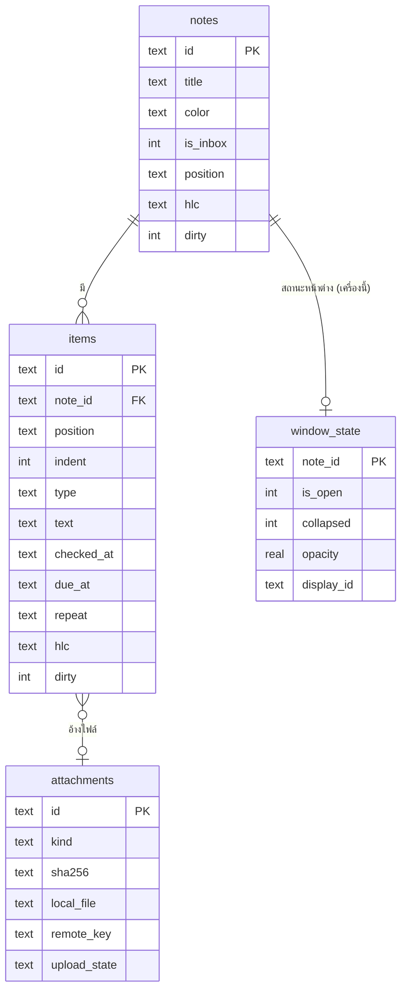

# 06 · Data model และการย้ายข้อมูล

Schema เต็ม (ทดสอบกับ SQLite 3.45 แล้ว): [`reference/0001_init.sql`](reference/0001_init.sql)

## 1. หลักการ

| หลัก | รายละเอียด |
| --- | --- |
| **รายการคือหน่วยข้อมูล** | โน้ต = ภาชนะ, งาน/ข้อความ/รูป = แถวใน `items` (ไม่มี HTML ทั้งก้อนอีกต่อไป) |
| **ไม่เก็บ HTML ดิบ** | ข้อความเก็บเป็น markdown-lite (§4) → ไม่มี XSS จากข้อมูล |
| **ลบแบบ tombstone** | `deleted_at` แทนการลบจริง (ซิงก์ต้องรู้ว่าอะไรถูกลบ); ล้างจริงหลัง 30 วันเมื่อซิงก์แล้ว |
| **ทุกแถวที่ซิงก์มี `hlc`, `field_hlc`, `dirty`** | `field_hlc` = นาฬิกาของแต่ละ field (ตัดสินว่าใครใหม่กว่าทีละ field), `dirty = 1` = ยังไม่ได้ส่งขึ้นเซิร์ฟเวอร์ |
| **ลำดับใช้ fractional index** | `position` เป็นสตริงที่แทรกระหว่างกันได้ไม่จำกัด → สองเครื่องแทรกพร้อมกันไม่ชน |
| **ของเฉพาะเครื่องแยกตาราง** | `window_state` และ settings ที่ `scope = 'device'` ไม่ซิงก์ |
| **ไฟล์อยู่นอก DB** | รูป/ไฟล์อยู่ใน `attachments/` อ้างด้วย id; DB เก็บแค่ metadata |

## 2. ตาราง



ตารางอื่น: `meta` (ค่าระบบ: device_id, hlc ล่าสุด, cursor ซิงก์), `settings`, `items_fts` (ค้นหา)

### ชนิดรายการ (`items.type`)
`task` · `text` · `heading` · `idea` · `link` (`url`) · `image` / `video` / `file` (`attachment_id`) · `folder` (`folder_path` + `folder_device_id`)

### เวลาและการเตือน
- `due_at` = เวลาของงานและเวลาเตือน; `has_time = 0` = มีแค่วัน (เตือนเวลาเริ่มต้นจาก settings, ค่าเริ่ม 09:00)
- เวลาเตือนจริง = `COALESCE(snoozed_until, due_at)`
- `fired_at` = เวลาเตือนจริงของรอบที่เด้งแล้ว (ซิงก์ด้วย จึงไม่เด้งซ้ำบนอีกเครื่อง)
- `repeat`: `daily` · `weekdays` · `weekly` (วันเดียวกับ `due_at`) · `monthly` · `every:3d` · `weekly:1,3,5` (0 = อาทิตย์)

## 3. รูปแบบค่า

| ค่า | รูปแบบ | ตัวอย่าง |
| --- | --- | --- |
| id | UUID v7 (เรียงตามเวลา) | `01928f7e-8c3a-7b2e-9f10-2c4d5e6f7a8b` |
| เวลา | ISO-8601 UTC มีมิลลิวินาที | `2026-10-07T03:00:00.000Z` |
| hlc | `<ms 13 หลัก>-<counter 4 หลัก>-<device 8 ตัว>` เปรียบเทียบแบบสตริงได้ | `1791338400000-0003-a1b2c3d4` |
| สี | ชื่อ | `yellow` |
| position | สตริง fractional index (base62) | `a0`, `a0V`, `a1` |

```js
// src/main/util/ids.js — UUID v7 ไม่ต้องลงไลบรารี
import { randomBytes } from 'node:crypto';
export function uuidv7(now = Date.now()) {
  const b = randomBytes(16);
  let ms = BigInt(now);
  for (let i = 5; i >= 0; i--) { b[i] = Number(ms & 0xffn); ms >>= 8n; }
  b[6] = (b[6] & 0x0f) | 0x70;   // version 7
  b[8] = (b[8] & 0x3f) | 0x80;   // variant
  const h = b.toString('hex');
  return `${h.slice(0, 8)}-${h.slice(8, 12)}-${h.slice(12, 16)}-${h.slice(16, 20)}-${h.slice(20)}`;
}
```

Fractional index: ใช้อัลกอริทึม `generateKeyBetween(a, b)` แบบเดียวกับไลบรารี `fractional-indexing` (ไม่มี dependency) — จะเพิ่มแพ็กเกจนั้นหรือคัดลอกโค้ดมาไว้ที่ `src/main/util/fractional-index.js` ก็ได้ (ระบุที่มาในหัวไฟล์)

## 4. Markdown-lite (ข้อความในรายการ)

| รูปแบบ | เขียนว่า | แสดงเป็น |
| --- | --- | --- |
| ตัวหนา | `**ข้อความ**` | `<strong>` |
| ตัวเอียง | `_ข้อความ_` | `<em>` |
| ขีดฆ่า | `~~ข้อความ~~` | `<s>` |
| ขีดเส้นใต้ | `++ข้อความ++` | `<u>` |
| ลิงก์ | `[ข้อความ](https://…)` | `<a>` เฉพาะ `http:`, `https:`, `mailto:` |
| ขึ้นบรรทัดใหม่ | `\n` | `<br>` |
| ตัวอักษรพิเศษ | `\*` `\_` `\~` `\+` `\[` `\\` | ตัวอักษรนั้นตรง ๆ |

- `src/shared/marks.js` มีแค่ 2 ฟังก์ชัน: `parse(text) → runs[]` และ `serialize(runs) → text`
- renderer แปลง runs → DOM ด้วย `document.createElement` เท่านั้น
- ข้อความค้นหา/ส่งออก .txt ใช้ `plain(text)` ที่ตัดสัญลักษณ์ออก
- เทสต์ต้องครอบ: round-trip, ข้อความไทยมีสระ/วรรณยุกต์, ลิงก์ `javascript:` ถูกตัดเป็นข้อความ

## 5. คำสั่ง SQL ที่ใช้บ่อย

```sql
-- งานวันนี้ (รวมเลยกำหนด) จากทุกโน้ต
SELECT i.*, n.title AS note_title, n.color AS note_color,
       COALESCE(i.snoozed_until, i.due_at) AS effective_at
FROM items i JOIN notes n ON n.id = i.note_id
WHERE i.deleted_at IS NULL AND n.deleted_at IS NULL
  AND i.checked_at IS NULL AND i.due_at IS NOT NULL
  AND COALESCE(i.snoozed_until, i.due_at) < :end_of_today
ORDER BY effective_at;

-- ติดดาวที่ไม่มีเวลา
SELECT i.* FROM items i JOIN notes n ON n.id = i.note_id
WHERE i.deleted_at IS NULL AND n.deleted_at IS NULL
  AND i.checked_at IS NULL AND i.starred = 1 AND i.due_at IS NULL;

-- เตือนที่ถึงเวลาและยังไม่เด้ง (scheduler ทุก 20 วินาที)
SELECT i.id, i.note_id, i.text, i.due_at, i.repeat, i.snoozed_until
FROM items i JOIN notes n ON n.id = i.note_id
WHERE i.deleted_at IS NULL AND n.deleted_at IS NULL AND i.checked_at IS NULL
  AND i.remind = 1 AND i.due_at IS NOT NULL
  AND COALESCE(i.snoozed_until, i.due_at) <= :now
  AND (i.fired_at IS NULL OR i.fired_at <> COALESCE(i.snoozed_until, i.due_at));

-- ค้นหา (คำค้น ≥ 3 ตัวอักษร); น้อยกว่านั้นใช้ text LIKE '%' || :q || '%'
SELECT i.id, i.note_id, i.text FROM items_fts f JOIN items i ON i.rowid = f.rowid
WHERE items_fts MATCH :quoted_q AND i.deleted_at IS NULL
ORDER BY rank LIMIT 50;

-- แถวที่ต้องส่งขึ้นเซิร์ฟเวอร์
SELECT * FROM items WHERE dirty = 1 LIMIT 500;
-- หลังส่งสำเร็จ: ล้าง dirty เฉพาะถ้าไม่มีใครแก้ระหว่างส่ง
UPDATE items SET dirty = 0 WHERE id = :id AND hlc = :sent_hlc;
```

> `:quoted_q` = คำค้นที่ครอบด้วย `"` และ escape `"` ภายในเป็น `""` เพื่อกัน syntax ของ FTS5

## 6. โฟลเดอร์ข้อมูล

```
<data>/                          %APPDATA%\WunWun\  (portable: <exe>\WunWunData\)
├─ wunwun.db  (+ -wal, -shm)
├─ attachments/<attachment_id>.<ext>
├─ attachments/thumbs/<attachment_id>.jpg
├─ backups/wunwun-YYYY-MM-DD.db  (7 วันล่าสุด, VACUUM INTO)
├─ legacy/                       ข้อมูล v1.x ที่นำเข้าแล้ว (ไม่ลบเอง)
├─ logs/main.log
└─ secrets.bin                   refresh token / AI key เข้ารหัสด้วย safeStorage
```

## 7. Migration

- ไฟล์ `src/main/db/migrations/NNNN_name.sql` **เพิ่มอย่างเดียว ห้ามแก้ไฟล์ที่ปล่อยไปแล้ว**
- `db/index.js` เปิด DB → `PRAGMA journal_mode = WAL; foreign_keys = ON; busy_timeout = 3000` → `PRAGMA quick_check` → รัน migration ที่ยังไม่รันใน transaction เดียวต่อไฟล์ → อัปเดต `meta.schema_version`
- ก่อนรัน migration ใด ๆ: `VACUUM INTO backups/pre-migrate-<version>.db`
- ทุก migration มีเทสต์: สร้าง DB เวอร์ชันก่อนหน้า + ข้อมูลตัวอย่าง → migrate → ตรวจค่า

## 8. สำรองและกู้คืน

| เหตุการณ์ | ทำอะไร |
| --- | --- |
| วันละครั้ง (ตอนว่าง) | `VACUUM INTO backups/wunwun-YYYY-MM-DD.db`, เก็บ 7 ไฟล์ |
| เปิดแอป | `PRAGMA quick_check`; ไม่ผ่าน → ย้ายไฟล์เสียเป็น `wunwun.db.corrupt-<ts>` → คัดลอกสำรองล่าสุดมาแทน → แจ้งผู้ใช้ว่าใช้ข้อมูลของวันไหน |
| ผู้ใช้กด "คืนจากสำรอง" | เลือกวัน → สำรองปัจจุบันก่อน → แทนที่ → รีสตาร์ต |
| ล็อกอินซิงก์แล้ว | เซิร์ฟเวอร์เป็นอีกชั้นสำรอง (ดึงคืนได้ทั้งหมด) |

## 9. นำเข้าข้อมูลเดิม v1.x (F-48)

ทำครั้งเดียวตอนเปิด v2 ครั้งแรก ถ้าเจอ `<data>/wunwun_data.json` (หรือ `notes-data.json` ของ v1.0 ยุคแรก) และ `meta.legacy_imported_at` ยังไม่มี

ขั้นตอน:
1. สำรอง: คัดลอก JSON, `.bak`, `backups/*.json`, `media/` ไปไว้ใน `legacy/`
2. อ่าน JSON ด้วยตัวอ่านเดียวกับ v1.1 (`mergeStore`)
3. แปลง HTML ของแต่ละโน้ตเป็นรายการ — ทำใน **หน้าต่างซ่อน** ที่ใช้ `DOMParser` (main ไม่มี DOM): main ส่ง `{contentHtml, completedHtml}` ไป, หน้าต่างตอบ `blocks[]` กลับ
4. เขียนทั้งหมดใน transaction เดียว + ตั้ง `meta.legacy_imported_at` ใน transaction เดียวกัน (รันซ้ำไม่ซ้ำ)
5. แจ้ง: "ย้ายข้อมูลจากเวอร์ชันเดิมแล้ว n โน้ต m รายการ"

| ของเดิม (v1.x) | ของใหม่ |
| --- | --- |
| `note.id` (เช่น `muxg75xi-xt577e`) | UUID v7 ใหม่ (ทำตารางจับคู่ระหว่างนำเข้า) |
| `note.color` hex | ชื่อสี: `#f1c40f`→yellow `#e74c3c`→red `#3498db`→blue `#2ecc71`→green `#9b59b6`→purple `#e67e22`→orange อื่น ๆ→yellow |
| `store.inboxNoteId` / `note.isInbox` | `notes.is_inbox = 1` |
| `windowBounds`, `collapsed`, `alwaysOnTop`, `store.openNoteIds` | `window_state` |
| `.inbox-head`, `.inbox-tip` | ข้าม |
| `.check-item` | `task`: ข้อความจาก `.check-text` (แปลง `b/strong/i/em/u/s/strike/a` เป็น markdown-lite), `data-checked`, `data-depth`→indent, `data-priority` high/medium/low→1/2/3, `data-starred`, `data-remind-at`→due_at, `data-repeat`, `data-has-time`, `data-when-source`; ถ้า `reminderFired[data-id] === data-remind-at` → `fired_at` |
| `.capture-idea` | `idea` (ตัด 💡 นำหน้า) |
| `.capture-link a`, ลิงก์ http เดี่ยว | `link` |
| `img.note-media` src `data:` | ถอด base64 → เขียนไฟล์ → `attachments` + `image` |
| `img/video` src `sticky-media://media/<name>` | คัดลอกจาก `legacy/media/<name>` → `attachments` |
| `a.folder-link` | `folder` (`data-path`, `folder_device_id` = เครื่องนี้) |
| `ul/ol > li`, `div`, `p`, ข้อความเปล่า | `text` ทีละบรรทัด (ข้ามบรรทัดว่าง) |
| รายการใน `completedHtml` | `task` ที่ `checked_at = note.updatedAt` |
| ข้อความ `@every-...` (ระบบซ้ำแบบเก่า) | คงไว้เป็นข้อความ (ไม่เดา) |

ชุดเทสต์: `tests/fixtures/legacy/` ต้องมีอย่างน้อย: v1.0 ล้วน, v1.1 ที่มี Inbox + เตือน + งานซ้ำ, โน้ตรูป base64 ใหญ่ 5 MB, โน้ตที่มี HTML แปลก (วางจาก Word), โน้ตว่าง, JSON เสีย (ต้องกู้จาก `.bak`)
