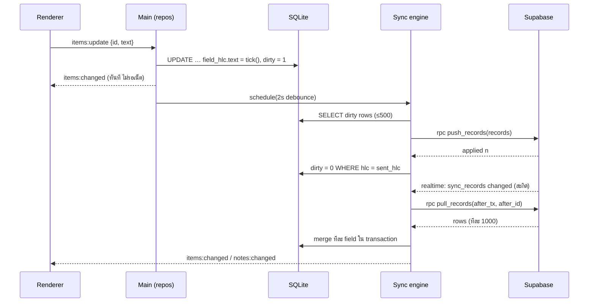

# 07 · ซิงก์หลายเครื่อง (device sync)

อ้างอิงโค้ดที่ทดสอบแล้ว:
- [`reference/sync-core.mjs`](reference/sync-core.mjs) — HLC + merge ทีละ field (เทสต์ 7 ข้อใน `sync-core.test.mjs`)
- [`reference/supabase_20261101000000_init.sql`](reference/supabase_20261101000000_init.sql) — ตาราง, RLS, `push_records`, `pull_records` (รันบน Postgres จริงผ่าน `supabase-check.mjs`)

---

## 1. เป้าหมาย

| ต้องได้ | ไม่ทำ (ตอนนี้) |
| --- | --- |
| ใช้ได้ครบโดยไม่ล็อกอิน (local-first) | แชร์โน้ตกับคนอื่น |
| แก้บนเครื่องไหนก็ได้ ออฟไลน์ก็ได้ แล้วรวมกันได้โดยไม่หาย | แก้ข้อความเดียวกันพร้อมกันแบบ Google Docs (CRDT ระดับตัวอักษร) |
| เห็นการเปลี่ยนแปลงบนอีกเครื่องภายใน 5 วินาทีเมื่อออนไลน์ | เข้ารหัสฝั่งเครื่อง (E2EE) — ทางเลือกในอนาคต (§13) |
| เตือนไม่เด้งซ้ำทุกเครื่อง | |

## 2. อะไรซิงก์ อะไรไม่ซิงก์

| ข้อมูล | ซิงก์ | เหตุผล |
| --- | --- | --- |
| โน้ต (`notes`) | ✅ | |
| รายการ (`items`) รวม `checked_at`, `due_at`, `fired_at`, `snoozed_until` | ✅ | `fired_at` กันเด้งซ้ำ |
| ไฟล์แนบ: metadata | ✅ | |
| ไฟล์แนบ: ตัวไฟล์ | ✅ (Storage) ตามขีดจำกัด | ดาวน์โหลดเมื่อจำเป็น |
| settings `scope = 'user'` (ธีม, ภาษา, รูปแบบเตือน, ห้ามรบกวน) | ✅ | เป็น 1 record ต่อผู้ใช้ |
| settings `scope = 'device'` (คีย์ลัด, เปิดพร้อมเครื่อง, มุม dock) | ❌ | แต่ละเครื่องต่างกัน |
| `window_state` (ตำแหน่ง, เปิด/ย่อ, ความโปร่งใส) | ❌ | จอคนละขนาด |
| `folder_path` | ✅ แต่ใช้ได้เฉพาะเครื่อง `folder_device_id` | path ของเครื่องอื่นไม่มีความหมาย |
| คีย์ AI, token | ❌ | ความลับเฉพาะเครื่อง |

## 3. ภาพรวมการทำงาน



## 4. ตัวตน

| สิ่ง | ที่มา | เก็บที่ |
| --- | --- | --- |
| `device_id` | UUID v7 สร้างครั้งแรกที่เปิดแอป | `meta.device_id` |
| `device_name` | `os.hostname()` (แก้ได้ใน Settings) | `meta.device_name` |
| `user_id` | Supabase Auth | `meta.user_id` |
| session (access + refresh token) | Supabase Auth | `secrets.bin` เข้ารหัสด้วย `safeStorage` — main เท่านั้น |

### 4.1 เข้าสู่ระบบด้วยอีเมล + รหัส 6 หลัก (Phase 3 ขั้นแรก)
1. Settings → บัญชี → ใส่อีเมล → `auth:sendCode` → main เรียก `supabase.auth.signInWithOtp({ email, options: { shouldCreateUser: true } })`
2. ผู้ใช้กรอกรหัสจากอีเมล → `auth:verify` → `supabase.auth.verifyOtp({ email, token, type: 'email' })`
3. สำเร็จ → บันทึก session (encrypted) → upsert `devices` → เริ่มซิงก์ครั้งแรก (§8)

ตั้งค่าใน Supabase: Email template ต้องมี `{{ .Token }}` (ไม่ใช้ magic link เพื่อเลี่ยงการทำ deep link ในเวอร์ชันแรก), จำกัดอัตราส่งอีเมลตามค่าเริ่มต้นของ Supabase

### 4.2 Google (ภายหลัง)
OAuth แบบ PKCE เปิดในเบราว์เซอร์ของระบบ → กลับเข้าแอปผ่าน `wunwun://auth/callback` (`app.setAsDefaultProtocolClient('wunwun')`; บน Windows URL มาทาง `second-instance` argv) — **ห้ามเปิดหน้า login ใน BrowserWindow ของแอป**

### 4.3 เก็บ session อย่างปลอดภัย

```js
// src/main/services/secrets.js
import { safeStorage } from 'electron';
import fs from 'node:fs';
export function createSecretStore(file) {
  const read = () => {
    if (!fs.existsSync(file) || !safeStorage.isEncryptionAvailable()) return {};
    try { return JSON.parse(safeStorage.decryptString(fs.readFileSync(file))); } catch { return {}; }
  };
  const write = (obj) => {
    if (!safeStorage.isEncryptionAvailable()) throw new Error('E_NO_SECURE_STORAGE'); // ห้าม fallback เป็นไฟล์เปล่า
    fs.writeFileSync(file + '.tmp', safeStorage.encryptString(JSON.stringify(obj)));
    fs.renameSync(file + '.tmp', file);
  };
  return {
    get: (k) => read()[k] ?? null,
    set: (k, v) => write({ ...read(), [k]: v }),
    remove: (k) => { const o = read(); delete o[k]; write(o); }
  };
}

// supabase-js ใน main: ใช้ store นี้เป็น storage ของ session
import { createClient } from '@supabase/supabase-js';
export function createSupabase(url, anonKey, secrets) {
  return createClient(url, anonKey, {
    auth: {
      persistSession: true, autoRefreshToken: true, detectSessionInUrl: false, flowType: 'pkce',
      storage: { getItem: (k) => secrets.get(k), setItem: (k, v) => secrets.set(k, v), removeItem: (k) => secrets.remove(k) }
    }
  });
}
```

## 5. นาฬิกาและการรวมข้อมูล

### 5.1 Hybrid Logical Clock (HLC)
- รูปแบบ `<ms 13 หลัก>-<counter 4 หลัก>-<device 8 ตัว>` → เรียงด้วยการเปรียบเทียบสตริงได้ (Postgres ต้อง `COLLATE "C"`)
- `tick()` ทุกครั้งที่เครื่องนี้เขียน · `receive(h)` ทุก field ที่ดึงมา (ให้การเขียนครั้งต่อไปใหม่กว่าเสมอ)
- เก็บค่าล่าสุดใน `meta.hlc_last` ทุกครั้งที่ commit → รีสตาร์ตแล้วไม่ย้อน
- ไม่เชื่อนาฬิกาเครื่องอื่นที่เร็วกว่าเกิน 1 วัน (กันเครื่องที่ตั้งเวลาผิดชนะทุกการแก้ไขตลอดไป)

### 5.2 Merge ทีละ field (last-writer-wins per field)
- แต่ละแถวมี `field_hlc = { text: h1, checked_at: h2, … }`
- รวมสองแถว: แต่ละ field เอาค่าที่ `field_hlc` ใหม่กว่า → **แก้คนละ field บนคนละเครื่องไม่ทับกัน**
- ตัวอย่างที่ทำให้ต้องทำทีละ field (ไม่ใช่ทั้งแถว): โน้ตบุ๊กออฟไลน์แก้ข้อความ 08:55, เดสก์ท็อปเด้งเตือน 09:00 (เขียน `fired_at`) → ถ้า merge ทั้งแถว ข้อความที่แก้จะหาย; ทีละ field เก็บได้ทั้งคู่ (เทสต์ข้อ 4)
- ลบ = field `deleted_at` ธรรมดา → ลบแล้วอีกเครื่องแก้ข้อความทีหลัง: ยังถูกลบอยู่ (ไม่ฟื้นเอง) แต่ข้อความใหม่ถูกเก็บ ถ้าผู้ใช้กู้คืนจะเห็นข้อความล่าสุด

### 5.3 เส้นทางการเขียนในเครื่อง
```js
// src/main/db/repos/items.js (ย่อ) — ทุกการแก้ผ่านฟังก์ชันนี้ ห้ามเขียน UPDATE ตรงจากที่อื่น
export function updateItem(db, clock, id, patch) {
  const row = getItem(db, id);
  const h = clock.tick();
  const fieldHlc = JSON.parse(row.field_hlc);
  for (const k of Object.keys(patch)) fieldHlc[k] = h;
  const sets = Object.keys(patch).map((k) => `${k} = :${k}`).join(', ');   // k มาจาก allowlist ของ validator เท่านั้น
  db.run(`UPDATE items SET ${sets}, updated_at = :now, hlc = :h, field_hlc = :fh, dirty = 1 WHERE id = :id`,
    { ...patch, now: new Date().toISOString(), h, fh: JSON.stringify(fieldHlc), id });
  setMeta(db, 'hlc_last', h);
  bus.emit('items:changed', { noteId: row.note_id, ids: [id] });
  syncEngine.schedule();
}
```

## 6. ส่งขึ้น (push)

1. รอ 2 วินาทีหลังการแก้ไขล่าสุด (debounce) หรือทันทีเมื่อกด "ซิงก์ตอนนี้"
2. ไฟล์แนบที่ `upload_state = 'queued'` → อัปโหลดไฟล์ก่อน (§9) แล้วค่อยส่ง record
3. อ่านแถว `dirty = 1` ทีละ 500 จาก notes → attachments → items → settings(user)
4. แปลงเป็น `{ id, kind, data, field_hlc, hlc }` (`data` = ทุกคอลัมน์ที่ซิงก์ ยกเว้น `hlc`, `field_hlc`, `dirty`)
5. `rpc('push_records', { p_records })`
6. สำเร็จ → `UPDATE … SET dirty = 0 WHERE id = ? AND hlc = ?` (ถ้ามีการแก้ระหว่างส่ง hlc จะไม่ตรง แถวจะถูกส่งรอบหน้าเอง)
7. ไม่สำเร็จ → backoff 5 s, 15 s, 1 m, 5 m (สูงสุด) ; 401 → refresh session ; refresh ไม่ได้ → สถานะ "ต้องเข้าสู่ระบบใหม่"

## 7. ดึงลง (pull)

- cursor = `(tx, id)` ของแถวสุดท้ายที่ได้ เก็บใน `meta.sync_cursor`
- เซิร์ฟเวอร์คืนเฉพาะแถวของ transaction ที่ **จบแล้ว** (`tx < pg_snapshot_xmin(pg_current_snapshot())`) → transaction ที่เริ่มก่อนแต่ commit ทีหลังจะไม่ถูกข้าม
- ดึงทีละ 1000 จนได้น้อยกว่า 1000
- ใช้แต่ละหน้าใน **transaction เดียว**:
  1. `clock.receive(h)` ทุก field
  2. `mergeRecord(local, remote)` → เขียนลงตารางตาม `kind`
  3. `dirty = merged.localAhead ? 1 : 0` (ถ้าในเครื่องยังมี field ใหม่กว่า ต้องส่งต่อ)
  4. กรณีพิเศษ Inbox (ด้านล่าง)
  5. เก็บ cursor ใหม่
- จบแล้วส่ง `items:changed` / `notes:changed` รวมครั้งเดียวต่อโน้ต

### Inbox ซ้ำ
สองเครื่องสร้าง Inbox ก่อนล็อกอิน → หลัง pull มี 2 ใบ (unique index ในเครื่องจะชน) → ก่อนเขียนโน้ต `is_inbox = 1` ให้:
1. เลือก **Inbox หลัก = สร้างก่อนสุด, เสมอกันใช้ id น้อยกว่า** (`canonicalInbox` — ทุกเครื่องได้ผลเหมือนกัน)
2. ใบที่ไม่ใช่หลัก: ย้ายรายการทั้งหมด (`note_id` = Inbox หลัก, hlc ใหม่), ตั้ง `is_inbox = 0`, `deleted_at = now`
3. ทุกเครื่องทำแบบเดียวกันได้ค่าเดียวกัน → merge ทีละ field ไม่ขัดกัน

## 8. ซิงก์ครั้งแรก (guest → บัญชี)

| สถานการณ์ | ทำอะไร |
| --- | --- |
| บัญชีใหม่ + มีข้อมูล guest | ทุกแถวยัง `dirty = 1` อยู่แล้ว → push ทั้งหมด |
| บัญชีเดิม (มีข้อมูลบนเซิร์ฟเวอร์) + เครื่องนี้มีข้อมูล guest | ถามครั้งเดียว: **"รวมข้อมูลในเครื่องเข้ากับบัญชี"** (ค่าเริ่มต้น) หรือ "ใช้ข้อมูลจากบัญชีอย่างเดียว" (สำรองข้อมูลในเครื่องเป็นไฟล์ก่อน) |
| เครื่องใหม่ไม่มีข้อมูล | pull ทั้งหมด (แสดงความคืบหน้า) |

## 9. ไฟล์แนบ

- อัปโหลดไป Storage bucket `attachments` path `<user_id>/<attachment_id>` (policy ให้แต่ละคนเข้าถึงแค่โฟลเดอร์ตัวเอง)
- ก่อนอัปโหลด: รูปที่ด้านยาวเกิน 1600 px ย่อด้วย `nativeImage.resize` แล้วเก็บเป็น JPEG คุณภาพ 85 (`toJPEG(85)`; รูปที่มีพื้นโปร่งใสเก็บเป็น PNG); ไฟล์เกินขีดจำกัด (ค่าเริ่ม 25 MB) → ไม่ซิงก์ตัวไฟล์ แสดง "ไฟล์นี้อยู่บนเครื่อง <ชื่อ>"
- dedupe ด้วย `sha256`: ถ้ามีไฟล์ hash เดียวกันในเครื่องอยู่แล้ว ใช้ร่วมกัน
- ดาวน์โหลด: รูป ≤ 2 MB ดาวน์โหลดเบื้องหลังทันที; อย่างอื่นเมื่อเปิดโน้ตหรือกดเปิด
- `upload_state`: local → queued → uploading → synced (หรือ failed + retry)

## 10. การเตือนกับหลายเครื่อง

- ทุกเครื่องเปิด scheduler; เครื่องที่เด้งก่อนเขียน `fired_at` แล้ว push ทันที (ไม่รอ debounce)
- เครื่องอื่นเห็น `fired_at` ตรงกับเวลาเตือน → ไม่เด้ง
- ถ้าสองเครื่องเด้งในช่วงเวลาที่ยังไม่ทันซิงก์ (< 5 วินาที หรือออฟไลน์) → เด้งทั้งสองเครื่อง (ยอมรับได้; ดีกว่าไม่เด้ง)
- กด "เลื่อน" บนเครื่องไหน → `snoozed_until` ซิงก์ไปทุกเครื่อง

## 11. ตัวกระตุ้นการซิงก์

| เหตุการณ์ | ทำ |
| --- | --- |
| ล็อกอินสำเร็จ / เปิดแอป (ล็อกอินอยู่) | push แล้ว pull |
| แก้ไขในเครื่อง | push หลัง 2 วินาที |
| realtime แจ้งว่า `sync_records` เปลี่ยน (filter `user_id=eq.<uid>`) | pull หลัง 1 วินาที |
| `online` / `powerMonitor.resume` / unlock | push + pull |
| ทุก 5 นาที | pull (กันพลาด realtime) |

Realtime ใช้เป็นแค่ "สะกิด" — ไม่นำ payload มาใช้ตรง ๆ ข้อมูลจริงมาจาก `pull_records` เสมอ (ได้ลำดับและ cursor ถูกต้อง)

## 12. สถานะ ออกจากระบบ ลบบัญชี

| สถานะ (`sync:status`) | แสดงใน Hub |
| --- | --- |
| `local` | ใช้ในเครื่อง |
| `synced` | ซิงก์แล้ว · <เวลา> |
| `pending` | กำลังส่ง n |
| `offline` | ออฟไลน์ · จะส่งเมื่อมีเน็ต |
| `error` | ซิงก์ไม่สำเร็จ ↻ (กดดูรายละเอียด) |
| `reauth` | ต้องเข้าสู่ระบบใหม่ |

- **ออกจากระบบ**: ถาม "เก็บข้อมูลไว้ในเครื่อง" (ค่าเริ่ม; ข้อมูลกลับเป็น guest, `dirty = 1` ทั้งหมด) หรือ "ลบข้อมูลในเครื่อง"
- **ออกจากระบบทุกเครื่อง**: `supabase.auth.signOut({ scope: 'global' })`
- **ลบบัญชี** (F-54): ขอรหัสอีเมลใหม่ → เรียก Edge Function `delete-account` (ดู `08-backend.md`) → ลบไฟล์ใน Storage + ผู้ใช้ใน Auth (แถวใน `sync_records`, `devices`, `ai_usage` หายตาม `on delete cascade`)
- **อุปกรณ์**: Settings แสดงรายการจาก `devices` (ชื่อ, แพลตฟอร์ม, เวอร์ชัน, เห็นล่าสุด) + ลบรายการได้

## 13. ทางเลือกในอนาคต: เข้ารหัสฝั่งเครื่อง (E2EE)

ทำได้โดยไม่เปลี่ยนโครง: เข้ารหัสค่าใน `data` ทีละ field (AES-GCM ด้วยกุญแจจากรหัสผ่านผู้ใช้ผ่าน scrypt) เพราะเซิร์ฟเวอร์ไม่ต้องอ่านค่า — merge ใช้แค่ `field_hlc` ที่ไม่เข้ารหัส. แลกกับ: ลืมรหัสผ่าน = ข้อมูลบนเซิร์ฟเวอร์กู้ไม่ได้ และ AI ฝั่งเซิร์ฟเวอร์ใช้ไม่ได้. ตัดสินใจหลัง v2.1 ตามเสียงผู้ใช้

## 14. การทดสอบ

| ระดับ | ทดสอบอะไร | เครื่องมือ |
| --- | --- | --- |
| unit | HLC, mergeRecord, Inbox หลัก, การแปลงแถว ↔ record | `node:test` (`sync-core.test.mjs` เป็นจุดเริ่ม) |
| เซิร์ฟเวอร์ | migration, RLS, push/pull, cursor | PGlite (`supabase-check.mjs`) ใน CI ทุก PR ที่แตะ `supabase/` |
| สองเครื่องจำลอง | engine จริง + เซิร์ฟเวอร์ปลอมในหน่วยความจำ: ออฟไลน์/ออนไลน์สลับ, แก้พร้อมกัน, ลบระหว่างแก้, Inbox ซ้ำ, กลาง push เน็ตหลุด | `node:test` |
| e2e | เปิดแอป 2 instance คนละ `userData` ชี้ Supabase local (`supabase start`) | Playwright `_electron` |
| ด้วยมือ | 2 เครื่อง Windows จริง, ปิด Wi-Fi, sleep/wake | checklist ใน `10-quality.md` |

ผลลัพธ์ที่ต้องเป็นจริงเสมอ (invariants):
1. หลังทุกเครื่องซิงก์จนนิ่ง ข้อมูลทุกเครื่องเท่ากันทุก field
2. ไม่มีรายการที่ผู้ใช้สร้างแล้วหายไปโดยไม่มี `deleted_at`
3. มี Inbox ที่ยังไม่ถูกลบได้แค่ 1 ใบ
4. `window_state` และ settings แบบ device ไม่เคยออกจากเครื่อง
