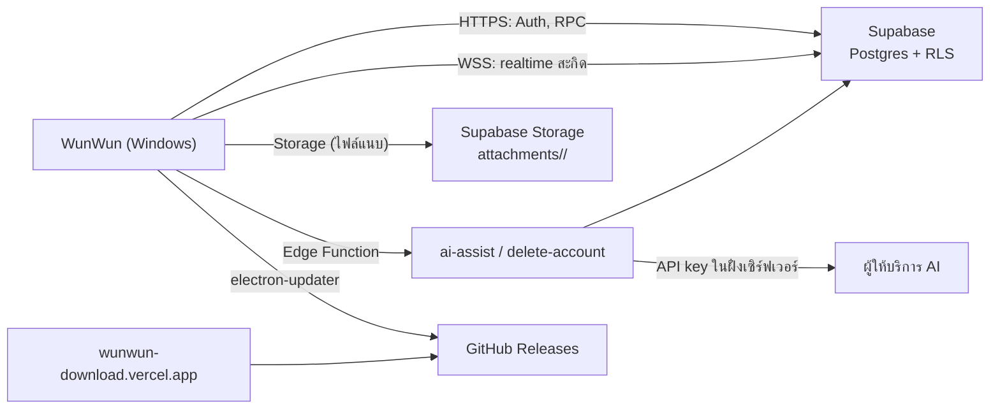

# 08 · ระบบหลังบ้าน

WunWun ไม่มีเซิร์ฟเวอร์ของตัวเอง ใช้บริการที่ดูแลง่ายสำหรับทีมคนเดียว:

| ส่วน | ใช้ | หน้าที่ |
| --- | --- | --- |
| ฐานข้อมูล + Auth + Storage + Realtime | **Supabase** | ซิงก์, บัญชี, ไฟล์แนบ |
| Edge Functions | Supabase (Deno) | ลบบัญชี, AI proxy + โควตา |
| ไฟล์ติดตั้ง + อัปเดต | **GitHub Releases** | `.exe`, `latest.yml`, `.blockmap` |
| เว็บไซต์ + หน้า download + นโยบายความเป็นส่วนตัว | **Vercel** (โฟลเดอร์ `web/`) | มีอยู่แล้ว |
| CI/CD | GitHub Actions | เทสต์, build, sign, release |



---

## 1. Supabase

### 1.1 โปรเจกต์และสภาพแวดล้อม

| env | ใช้ | ตั้งอย่างไร |
| --- | --- | --- |
| local | พัฒนา + e2e | `supabase start` (ต้องมี Docker) → URL `http://127.0.0.1:54321` |
| production | ผู้ใช้จริง | โปรเจกต์ใน region **Singapore (ap-southeast-1)** — ใกล้ผู้ใช้ไทยที่สุด |

- แอปอ่าน URL และ publishable/anon key จาก `src/main/config.js` (ค่าสาธารณะ ใส่ในโค้ดได้เมื่อเปิด RLS ครบ) และให้ env `WUNWUN_SUPABASE_URL`, `WUNWUN_SUPABASE_ANON_KEY` ทับได้ตอน dev
- **service_role key ห้ามอยู่ในแอปหรือ repo** — อยู่ใน secrets ของ Edge Functions เท่านั้น
- ตาราง `wunwun_notes` เดิมใน `supabase/schema.sql` ไม่มีผู้ใช้จริง (sync เป็น stub) → ลบทิ้งได้ใน migration ใหม่

### 1.2 Migration
- ไฟล์: `supabase/migrations/20261101000000_init.sql` = [`reference/supabase_20261101000000_init.sql`](reference/supabase_20261101000000_init.sql) (ผ่าน parser ของ Postgres และรันบน Postgres จริงแล้ว)
- ขั้นตอน: แก้ SQL → `supabase db reset` (local) → `node docs/plan/reference/supabase-check.mjs <ไฟล์>` → PR → `supabase db push` ไป production
- เพิ่มอย่างเดียว ห้ามแก้ migration ที่ push ไปแล้ว

### 1.3 สิ่งที่อยู่ในฐานข้อมูล

| ออบเจกต์ | สรุป |
| --- | --- |
| `sync_records` | ทุก record ที่ซิงก์ (`kind`: note, item, attachment, settings) + `field_hlc` + `tx` |
| `push_records(jsonb)` | รับ ≤ 500 record, merge ทีละ field (`security invoker` → RLS ทำงาน) |
| `pull_records(after_tx, after_id, limit)` | คืนแถวของ transaction ที่จบแล้ว เรียงตาม `(tx, id)` |
| `devices` | รายการอุปกรณ์ของผู้ใช้ |
| `ai_usage` + `ai_consume()` | นับโควตา AI ต่อวัน (เรียกได้เฉพาะ service role) |
| bucket `attachments` | ส่วนตัว, 25 MB/ไฟล์, path ต้องขึ้นต้นด้วย `<user_id>/` |
| publication `supabase_realtime` | เพิ่ม `sync_records` เพื่อให้แอปถูกสะกิด |

### 1.4 ตั้งค่า Auth
- เปิด Email provider; **Email OTP** (template มี `{{ .Token }}`), อายุรหัส 10 นาที
- ปิด magic link ใน template ระยะแรก (ไม่ต้องทำ deep link)
- Site URL = `https://wunwun-download.vercel.app`
- Redirect URLs (เมื่อทำ Google): `wunwun://auth/callback`
- ถ้าเริ่มมีสแปมสมัคร: เปิด CAPTCHA (Turnstile/hCaptcha) ใน Auth settings
- SMTP: ใช้ของ Supabase ช่วงทดสอบ; ก่อนเปิดจริงตั้ง SMTP ของตัวเอง (ส่งได้มากกว่าและไม่ติดสแปม)

### 1.5 Edge Functions

#### `delete-account`
```ts
// supabase/functions/delete-account/index.ts
import { createClient } from 'npm:@supabase/supabase-js@2';

const json = (body: unknown, status = 200) =>
  new Response(JSON.stringify(body), { status, headers: { 'Content-Type': 'application/json' } });

Deno.serve(async (req) => {
  if (req.method !== 'POST') return json({ error: 'E_METHOD' }, 405);
  const authHeader = req.headers.get('Authorization') ?? '';
  const url = Deno.env.get('SUPABASE_URL')!;
  const userClient = createClient(url, Deno.env.get('SUPABASE_ANON_KEY')!, { global: { headers: { Authorization: authHeader } } });
  const { data: { user }, error } = await userClient.auth.getUser();
  if (error || !user) return json({ error: 'E_AUTH' }, 401);

  // ต้องยืนยันตัวตนด้วยรหัสอีเมลภายใน 10 นาทีที่ผ่านมา (claim amr ของ JWT)
  const claims = JSON.parse(atob(authHeader.split('.')[1].replace(/-/g, '+').replace(/_/g, '/')));
  const recent = (claims.amr ?? []).some((a: { timestamp: number }) => Date.now() / 1000 - a.timestamp < 600);
  if (!recent) return json({ error: 'E_REAUTH' }, 403);

  const admin = createClient(url, Deno.env.get('SUPABASE_SERVICE_ROLE_KEY')!);
  for (;;) {
    const { data: files, error: listErr } = await admin.storage.from('attachments').list(user.id, { limit: 1000 });
    if (listErr) return json({ error: 'E_STORAGE' }, 500);
    if (!files?.length) break;
    await admin.storage.from('attachments').remove(files.map((f) => `${user.id}/${f.name}`));
  }
  const { error: delErr } = await admin.auth.admin.deleteUser(user.id); // sync_records, devices, ai_usage ลบตาม cascade
  if (delErr) return json({ error: 'E_DELETE' }, 500);
  return json({ ok: true });
});
```

#### `ai-assist`
```ts
// supabase/functions/ai-assist/index.ts — ผู้ใช้ไม่ต้องมีคีย์เอง, จำกัดต่อวัน
import { createClient } from 'npm:@supabase/supabase-js@2';
const LIMIT = Number(Deno.env.get('AI_DAILY_LIMIT') ?? '50');
const PROMPTS: Record<string, string> = {
  summarize: 'สรุปข้อความต่อไปนี้เป็นภาษาไทย 1-3 หัวข้อสั้น ๆ',
  checklist: 'แปลงข้อความเป็นรายการงาน บรรทัดละ 1 งาน ไม่ใส่สัญลักษณ์นำหน้า',
  extract:   'ดึงเฉพาะสิ่งที่ต้องทำ บรรทัดละ 1 งาน ถ้ามีวันเวลาให้คงไว้ในบรรทัด',
  rewrite:   'เรียบเรียงให้อ่านง่าย คงความหมายเดิม ภาษาเดิม',
  split:     'แยกประโยคเป็นงานย่อย บรรทัดละ 1 งาน คงคำบอกวันเวลาไว้กับงานที่เกี่ยวข้อง'
};

Deno.serve(async (req) => {
  const url = Deno.env.get('SUPABASE_URL')!;
  const userClient = createClient(url, Deno.env.get('SUPABASE_ANON_KEY')!,
    { global: { headers: { Authorization: req.headers.get('Authorization') ?? '' } } });
  const { data: { user } } = await userClient.auth.getUser();
  if (!user) return new Response('unauthorized', { status: 401 });

  const { action, text } = await req.json().catch(() => ({}));
  if (!PROMPTS[action] || typeof text !== 'string' || text.length === 0 || text.length > 4000)
    return new Response('bad request', { status: 400 });

  const admin = createClient(url, Deno.env.get('SUPABASE_SERVICE_ROLE_KEY')!);
  const day = new Date().toISOString().slice(0, 10);
  const { data: allowed } = await admin.rpc('ai_consume', { p_user: user.id, p_day: day, p_limit: LIMIT });
  if (!allowed) return new Response(JSON.stringify({ error: 'E_QUOTA' }), { status: 429 });

  const result = await callProvider(PROMPTS[action], text); // adapter: เลือกผู้ให้บริการผ่าน env (AI_PROVIDER, AI_MODEL, AI_API_KEY)
  return new Response(JSON.stringify({ text: result }), { headers: { 'Content-Type': 'application/json' } });
});
```
- ไม่เก็บข้อความที่ส่งมา (ไม่ log เนื้อหา)
- เลือกผู้ให้บริการ AI ตอนเริ่ม Phase 4 (ดูราคา/ภาษาไทย/นโยบายข้อมูล) — โค้ดแอปไม่ผูกกับเจ้าไหน

### 1.6 ดูแลระบบ
- ก่อนทุก release ที่แตะฐานข้อมูล: ตรวจ Security/Performance Advisors ใน dashboard (หรือ Supabase MCP `get_advisors`)
- เปิด spend cap; ตั้งแจ้งเตือนการใช้งานที่ 80% ของโควตา
- ดู log: Auth (สมัคร/ล็อกอินผิดปกติ), Edge Functions (error rate), Postgres (slow query)
- สำรอง: Pro มี daily backup 7 วัน; ข้อมูลผู้ใช้มีสำเนาในเครื่องผู้ใช้ทุกคนอยู่แล้ว

### 1.7 ต้นทุน
- Free: DB 500 MB, Storage 1 GB, 50,000 MAU, **โปรเจกต์ถูกพักเมื่อไม่มีการใช้งาน 1 สัปดาห์** → ใช้ได้แค่ช่วง beta ปิด
- Pro: $25+/เดือน, 100,000 MAU, disk 8 GB ([Supabase pricing](https://supabase.com/pricing))
- ประมาณการ: ข้อความล้วน ~1 KB/รายการ → 500 MB ≈ 500,000 รายการทั้งระบบ; ไฟล์แนบคือตัวกินพื้นที่หลัก → จำกัดขนาด/จำนวนต่อผู้ใช้

---

## 2. GitHub Releases + อัปเดต

- `electron-builder` publish provider `github` → แนบ `WunWun-Setup-<ver>.exe`, `.blockmap`, `latest.yml`
- ตั้ง `nsis.artifactName: "WunWun-Setup-${version}.${ext}"` และให้หน้าเว็บลิงก์ไป `https://github.com/passawutaplus/wunwun/releases/latest` (ไม่ต้องแก้ลิงก์ทุก release)
- `electron-updater`: ตรวจตอนเปิด + ทุก 6 ชม., ดาวน์โหลดเบื้องหลัง, ถามผู้ใช้ก่อนติดตั้ง, มีช่อง beta (`allowPrerelease`) ใน Settings
- release ทำผ่าน CI เท่านั้น (ดู `10-quality.md`) — ห้าม build จากเครื่องส่วนตัวแล้วอัปโหลดเอง

## 3. เว็บไซต์ (`web/`)

| หน้า | เนื้อหา |
| --- | --- |
| `/` | จุดขาย: จดด่วน, เตือนภาษาไทย, ใช้ออฟไลน์, ฟรี; ปุ่มดาวน์โหลด; ภาพหน้าจอจริง |
| `/privacy` | **ต้องมีก่อนเปิดบัญชี/ซิงก์**: เก็บอะไร (อีเมล, ข้อมูลโน้ตที่ซิงก์), เก็บที่ไหน (Supabase, Singapore), เก็บนานแค่ไหน, ลบบัญชีอย่างไร, ส่งออกข้อมูลอย่างไร, AI ส่งอะไรออกไป, ช่องทางติดต่อ |
| `/changelog` | สร้างจาก release notes |
| `/help` | คีย์ลัด, วิธีเขียนวันเวลา, ย้ายข้อมูล, ปัญหาที่พบบ่อย (SmartScreen, การแจ้งเตือนไม่ขึ้น) |

> ผู้ใช้ส่วนใหญ่อยู่ในไทย → ตรวจข้อกำหนดของ พ.ร.บ.คุ้มครองข้อมูลส่วนบุคคล (PDPA) สำหรับการเก็บอีเมลและข้อมูลที่ซิงก์ (การแจ้งวัตถุประสงค์, สิทธิ์ลบ/ขอสำเนา) — เอกสารนี้ไม่ใช่คำแนะนำทางกฎหมาย
