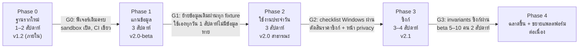

# 11 · Roadmap และรายการงานสำหรับ Claude Code

ทุก phase จบด้วยของที่ใช้ได้จริง และมี **ประตู (gate)** ที่ต้องผ่านก่อนเริ่ม phase ถัดไป
เวลาเป็นการประมาณสำหรับคนเดียวทำงานเต็มเวลาร่วมกับ Claude Code

กติกาทุกงาน: ทำตาม `CLAUDE.md`, ผ่าน Definition of Done ใน `10-quality.md §6`, commit ละงาน (ข้อความ commit บอก ID เช่น `T1.5: block editor keymap`)

---

## Phase 0 · ฐานรากใหม่ (ฟีเจอร์เท่าเดิม โครงใหม่)

จุดเริ่ม: branch `sprint1-capture-remind` (v1.1.0) ใน repo

| ID | งาน | ไฟล์หลัก | เสร็จเมื่อ |
| --- | --- | --- | --- |
| T0.1 | อัปเกรด Electron 33 → 44 ทีละช่วง อ่าน breaking changes ของ 34–44, แก้ API ที่เปลี่ยน | `package.json` | `npm start` ไม่มี error/deprecation; จดด่วน, เตือน, แคปจอ, ลากไฟล์ ทำงาน (ทดสอบมือ + เทสต์เดิม 39 ข้อผ่าน) |
| T0.2 | ย้ายเป็น ESM + โครง `src/` ตาม `05-architecture.md §3`; แยก `main.js` เป็นโมดูล `app/`, `windows/`, `services/`; ยังใช้ JSON store เดิมชั่วคราวใน `src/main/legacy-store.js` | ทั้ง repo | พฤติกรรมเหมือน v1.1.0 ทุกข้อ, `main/index.js` < 80 บรรทัด |
| T0.3 | Custom protocol `app://` + `wunwun-media://`, CSP เป็น header, `windows/registry.js` ค่าความปลอดภัยรวม, `sandbox: true`, permission handler ปฏิเสธทั้งหมด | `src/main/app/protocol.js`, `src/main/windows/registry.js` | ไม่มีหน้าไหนโหลดจาก `file://`; e2e ทดสอบว่า `window.require` ไม่มี |
| T0.4 | IPC router + validator; ย้าย handler เดิมทั้ง 30 ตัวเข้า `routes/`; preload ใหม่ (`call`, `on`, `pathForFile`); ลบ `open-path` แบบรับ path ใดก็ได้ | `src/main/ipc/*`, `src/preload/index.cjs` | ส่ง channel/payload ผิด → ถูกปฏิเสธ (มีเทสต์) |
| T0.5 | ย้ายคอนฟิก build ไป `electron-builder.yml`, ตั้ง icon, `artifactName`, publish github, fuses (afterPack หรือคอนฟิกในตัว) | `electron-builder.yml`, `scripts/after-pack.cjs` | `npm run dist` ได้ exe ที่ fuses ถูกตั้ง และแอปทำงานได้ |
| T0.6 | โครงเทสต์: ย้ายเทสต์ไป `tests/unit`, `jsconfig.json` + `npm run typecheck`, Playwright e2e + test hooks (`10-quality.md §1.2`) + e2e ข้อ 2, 5, 6, CI workflow | `tests/`, `.github/workflows/ci.yml` | CI บน windows-latest เขียว |

**G0:** ทุกอย่างที่ v1.1.0 ทำได้ยังทำได้, `sandbox: true`, CI เขียว

---

## Phase 1 · แกนข้อมูล (SQLite + block editor)

| ID | งาน | ไฟล์หลัก | เสร็จเมื่อ |
| --- | --- | --- | --- |
| T1.1 | **Spike:** `node:sqlite` ใน Electron 44 — เปิด DB, WAL, `STRICT`, FTS5 `tokenize='trigram'`, insert 10,000 แถว, query Today < 10 ms; ถ้าข้อใดไม่ได้ → ใช้ `better-sqlite3` | `docs/adr/001-sqlite-driver.md` | ADR ระบุผลวัดและตัวเลือก |
| T1.2 | `db/`: driver adapter, ตัวรัน migration, `0001_init.sql` (จาก `reference/`), `quick_check` + กู้คืน, สำรอง `VACUUM INTO` รายวัน, `util/ids.js` (uuidv7), `util/fractional-index.js`, `services/sync/hlc.js` (จาก `reference/sync-core.mjs`), repos ทุกตาราง (เขียนผ่าน `field_hlc` เสมอ) | `src/main/db/*`, `src/main/util/*` | unit test repos ครบ CRUD + tombstone + dirty |
| T1.3 | `shared/marks.js` (parse/serialize/plain) + DOM renderer ฝั่ง renderer | `src/shared/marks.js`, `src/renderer/note/editor/marks-dom.js` | เทสต์ round-trip, ไทย, `javascript:` ถูกตัด |
| T1.4 | นำเข้าข้อมูล v1.x ด้วยหน้าต่างซ่อน DOMParser ตาม `06-data-model.md §9` + fixtures ทุกแบบ | `src/main/db/legacy-import.js`, `src/renderer/importer/` | ทุก fixture ผ่าน, รันซ้ำไม่ซ้ำ, `legacy/` มีไฟล์เดิม |
| T1.5 | Block editor: แถวต่อรายการ, keymap (`03-ux-ui.md §4.3`), วาง (§4.6), ลากเรียง/ย้ายโน้ต, undo/redo, when-chip + เมนู, ช่องเพิ่มด้านล่าง, รองรับ IME | `src/renderer/note/**` | e2e ข้อ 3, 4 ผ่าน; ไม่มี `execCommand`, ไม่มี `innerHTML` กับข้อมูลผู้ใช้ |
| T1.6 | Scheduler เตือนบน SQLite (query `06 §5`), งานซ้ำทุกแบบ (เพิ่ม `every:Nd`, `weekly:1,3,5` ใน when-parser + เทสต์), `powerMonitor` resume, สรุปที่พลาด | `src/main/services/reminders.js`, `src/shared/when-parser.js` | เทสต์นาฬิกาปลอม: เด้งตรงเวลา, ไม่ซ้ำ, งานซ้ำเลื่อนถูก |
| T1.7 | `window_state` + คืนตำแหน่ง + หลายจอ; จดด่วนเขียน `items` ลง Inbox; Hub แสดงรายการโน้ตจาก DB | `src/main/windows/placement.js`, `src/main/services/capture.js` | e2e ข้อ 6; ถอดจอจำลองแล้วโน้ตย้าย |
| T1.8 | ลบ JSON store และโค้ด HTML-blob ทั้งหมด (เหลือแค่ importer) | — | `grep contentHtml src/` เจอแค่ใน importer |

**G1:** fixture ย้ายข้อมูลผ่านทั้งหมด; เจ้าของใช้เองทุกวัน 1 สัปดาห์ไม่มีข้อมูลหาย; งบ startup/editor ผ่าน

---

## Phase 2 · ใช้งานประจำวัน → v2.0 สาธารณะ

| ID | งาน | ไฟล์หลัก | เสร็จเมื่อ |
| --- | --- | --- | --- |
| T2.1 | Hub 4 แท็บ: วันนี้ (F-23) / Inbox / โน้ต / เสร็จแล้ว + ค้นหา Ctrl+K (F-30) | `src/renderer/hub/**`, `src/main/services/search.js` | e2e ข้อ 9; ค้น 10,000 รายการ < 50 ms |
| T2.2 | Popup เตือน + เลื่อนเวลา + ห้ามรบกวน + เลือกรูปแบบ (F-21) | `src/main/windows/reminder.js`, `src/renderer/reminder/` | e2e ข้อ 5; ไม่ขโมยโฟกัส |
| T2.3 | หน้าต่าง Settings (ยกเว้นบัญชี/AI): คีย์ลัดแบบกดบันทึก + ตรวจชน, เปิดพร้อมเครื่อง, ธีม, ความโปร่งใส, เวลาเริ่มต้น | `src/renderer/settings/`, `src/main/ipc/routes/settings.js` | F-41, F-42 AC ผ่าน |
| T2.4 | Dock รวมหน้าต่างเดียว (F-17) | `src/main/windows/dock.js`, `src/renderer/dock/` | e2e ข้อ 10; RAM ลดลงเมื่อย่อโน้ต (วัดใน perf) |
| T2.5 | ไฟล์แนบ: เก็บไฟล์ + thumbnail, การ์ดไฟล์, เปิดไฟล์อย่างปลอดภัย, วางรูป, แคปจอ → จดด่วน (F-04, F-05, F-14) | `src/main/services/media.js` | ไม่มี base64 ใน DB; ไฟล์โปรแกรมถามก่อนเปิด |
| T2.6 | ส่งออกทั้งหมด/นำเข้าโฟลเดอร์, ส่งออก Markdown (F-18) | `src/main/services/export.js` | เทสต์ round-trip |
| T2.7 | Tokens + ธีมสว่าง + ไอคอน SVG ชุดเดียว + ผ่านการเข้าถึง (F-46) | `src/renderer/shared/*` | contrast ทุกคู่ ≥ 4.5:1 (สคริปต์ตรวจ), ใช้ด้วยคีย์บอร์ดได้ทั้งแอป |
| T2.8 | ครั้งแรกที่เปิด (F-47) | `src/main/services/onboarding.js` | e2e ข้อ 1 |
| T2.9 | อัปเดตอัตโนมัติ + release workflow + เซ็นโค้ด (ตามที่ได้) + หน้าเว็บ download/help/changelog (F-43) | `src/main/app/updater.js`, `.github/workflows/release.yml`, `web/` | อัปเดตจาก 2.0.0-beta → 2.0.0 ได้จริงบน VM |
| T2.10 | Portable mode (F-44) | `src/main/app/paths.js` | รันจาก USB ข้อมูลอยู่ข้าง exe |

**ก่อนเริ่ม Phase 3 (ตัดสินใจ):** แผนราคา/ขีดจำกัดของซิงก์, ใช้ Supabase Pro หรือไม่, เปิดหน้า `/privacy`

**G2:** checklist `10-quality.md §5` ผ่านบน Windows 10/11 → ปล่อย v2.0.0

---

## Phase 3 · ซิงก์ → v2.1

| ID | งาน | ไฟล์หลัก | เสร็จเมื่อ |
| --- | --- | --- | --- |
| T3.1 | โปรเจกต์ Supabase (Singapore) + migration จาก `reference/` + `supabase start` สำหรับ dev + `tests/server/` (ปรับ `supabase-check.mjs` ให้อ่านทุกไฟล์ใน `supabase/migrations/` ตามลำดับ) | `supabase/**`, `tests/server/` | `npm run test:server` เขียวใน CI |
| T3.2 | `secrets.js` + supabase client ใน main + เข้าสู่ระบบด้วยรหัสอีเมลใน Settings + upsert `devices` (F-50) | `src/main/services/secrets.js`, `src/main/services/sync/auth.js` | token ไม่เคยถึง renderer (เทสต์), ล็อกอิน/ออกได้ |
| T3.3 | Sync engine: แปลงแถว ↔ record, push (dirty, batch 500), pull (cursor `(tx,id)`, ทีละ 1000), merge ทีละ field, `localAhead`, Inbox หลัก, guest → บัญชี, backoff, สถานะ | `src/main/services/sync/{engine,merge,records}.js` | เทสต์สองเครื่องจำลองทุกกรณีใน `07-sync.md §14` ผ่าน |
| T3.4 | Realtime สะกิด + ตัวกระตุ้นอื่น (online, resume, 5 นาที) | `src/main/services/sync/engine.js` | แก้เครื่อง A เห็นบน B < 5 วินาที |
| T3.5 | ซิงก์ไฟล์แนบ (F-52) | `src/main/services/sync/attachments.js` | อัปโหลด/ดาวน์โหลด/dedupe/ขีดจำกัด ทำงาน |
| T3.6 | UI: สถานะใน Hub, หมวดบัญชีใน Settings, ออกจากระบบ (เก็บ/ลบ), ออกทุกเครื่อง, รายการอุปกรณ์ (F-53) | `src/renderer/hub`, `src/renderer/settings` | ตาม `07-sync.md §12` |
| T3.7 | Edge Function `delete-account` + UI ยืนยันรหัสใหม่ (F-54) | `supabase/functions/delete-account/` | ลบแล้วไม่มีแถว/ไฟล์ของผู้ใช้เหลือ (ตรวจด้วย service role) |
| T3.8 | e2e สอง instance กับ Supabase local + ทดสอบมือ 2 เครื่อง | `tests/e2e/sync.spec.js` | invariants 4 ข้อใน `07-sync.md §14` เป็นจริง |

**G3:** beta ปิด 5–10 คน 2 สัปดาห์ ไม่มี `data-loss` → ปล่อย v2.1.0

---

## Phase 4 · ฉลาดขึ้นและขยายแพลตฟอร์ม (ต่อเนื่อง)

| ID | งาน | หมายเหตุ |
| --- | --- | --- |
| T4.1 | สรุปตอนเช้า + ถามย้ายงานค้างตอนสิ้นวัน (F-24, F-25) | ปิดได้, น้ำเสียงไม่กดดัน |
| T4.2 | `#แท็ก` (F-31) | ไม่มีหน้าจัดการแท็ก |
| T4.3 | AI: ADR เลือกผู้ให้บริการ, `ai-assist` function, ใช้คีย์ตัวเอง, แตกประโยค, คำสั่งบนข้อความที่เลือก (F-60–62) | ปิดเป็นค่าเริ่มต้น |
| T4.4 | when-parser: "สิ้นเดือน", "ก่อนเที่ยง", "ทุกจันทร์ พุธ ศุกร์" ฯลฯ | เทสต์ก่อนเสมอ |
| T4.5 | macOS (F-70) | notarize, menubar, ทดสอบคีย์ลัด |
| T4.6 | เว็บดูบนมือถือ (F-71) | ใช้ `src/shared` + renderer modules ร่วม |

---

## ความเสี่ยงของแผน

| ความเสี่ยง | ผลกระทบ | วิธีรับมือ |
| --- | --- | --- |
| `node:sqlite` ใน Electron ไม่มี FTS5/trigram | ต้องใช้ native module | T1.1 ตัดสินก่อน; `better-sqlite3` เป็นทางสำรองที่ใช้กันแพร่หลาย |
| Block editor ทำนานกว่าคาด | Phase 1 ยืด | ทำ keymap ทีละกลุ่ม, ใช้ e2e เป็นตัววัด, ตัด undo/redo ข้ามรายการไป Phase 2 ได้ |
| Playwright Electron ยังเป็น experimental | e2e ไม่เสถียร | เก็บ e2e ให้น้อยแต่สำคัญ, ส่วนที่เหลือเป็น unit |
| ไม่ได้ใบรับรองเซ็นโค้ด | คนกลัวติดตั้ง | สมัคร SignPath เร็ว (ตั้งแต่ Phase 2 เริ่ม), หน้า help อธิบาย SmartScreen |
| ต้นทุน Supabase | ต้องจ่ายรายเดือน | ตัดสินใจราคาก่อน Phase 3, จำกัดไฟล์แนบ |
| ขอบเขตบวม | ไม่มีอะไรปล่อย | ฟีเจอร์นอก `04-features.md` ต้องผ่านหลัก 7 ข้อและเพิ่มใน backlog ก่อน |
